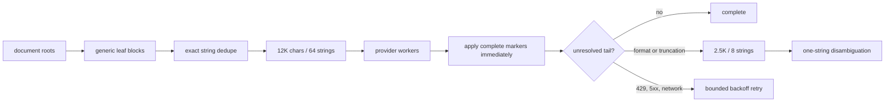

> **HISTORICAL** — superseded by AI_PAGE_TRANSLATION_VNEXT.md; kept for archaeology.

# Google-style AI 페이지 연속 번역

> **역사 문서 — production source of truth가 아님.** 이 문서의 routing, batch, budget,
> retry 설명은 이전 실험을 기록한다. 현재 cloud `auto`/default는
> [vNext 운영 계약](./AI_PAGE_TRANSLATION_VNEXT.md)을 따르고, stable은
> [명시적 rollback](./AI_PAGE_TRANSLATION_STABLE.md)으로만 유지한다. 특히 이 문서의
> Google-style runtime을 현재 기본 경로로 해석하지 않는다.
>
> 기준일: 2026-07-13 · 대상: OpenAI, Google AI Studio, OpenAI-compatible

## 목표와 사실 관계

Google 페이지 번역의 비공개 번역 backend를 복제한 구현은 아니다. 확장에서 확인 가능한 실행 특성인
문서 전체 수집, 안정적인 작은 작업 단위, 연속 처리, DOM 제자리 반영을 LLM 호출에 맞게 다시 설계했다.

기본 경로에는 수동 `Token budget reached` 상태가 없다. 토큰은 실제 provider usage가 있으면 그대로
합산하고, 없을 때만 보수 추정하여 표시한다. `hardTokenBudget`은 명시적 V2 preview에서만 중단 조건으로
사용한다.

배너 진행률은 DOM 문자열 수가 아니라 최초 provider-safe packing으로 만든 **논리 batch 수**를 표시한다.
京阪本線 구조 측정 기준 1,646개 고유 문자열은 27 batches로 표시된다. 복구 요청은 이미 성공한 문자열을
다시 목표로 추가하지 않으므로 진행률 분모를 부풀리지 않으며, 실제 provider 호출 횟수는 별도 telemetry로
계속 센다.

## 실행 흐름



### 수집과 적용

-   표준 block/ARIA/hidden 의미만 사용하며 사이트별 selector는 두지 않는다.
-   같은 원문은 한 번만 생성하고 현재 DOM의 모든 대상에 공유한다.
-   `translate=no`, `.notranslate`, hidden/script/style/template 영역은 제외한다.
-   본문이 있는 요소의 중복 tooltip은 보내지 않는다.
-   element를 교체하지 않고 기존 text node와 허용된 접근성 속성만 수정한다.
-   viewport 좌표, 스크롤 위치, 화면 근처 우선순위를 읽지 않는다.
-   MutationObserver는 새로 추가되거나 바뀐 leaf만 이어서 수집한다.

## 실패 복구

1. 정상 marker는 즉시 적용하고 다시 보내지 않는다.
2. background의 `partialTranslation`과 직접 응답의 `partialOutput`을 모두 읽는다.
3. 출력 잘림이나 marker 누락은 해결되지 않은 문자열만 최대 8개씩 축소한다.
4. 마지막 하나는 marker 없는 단일 응답도 안전하게 연결한다.
5. 429, 5xx, timeout, network 오류는 동일한 미해결 꼬리만 지수 backoff로 최대 3회 재시도한다.
6. 인증키 누락, 잘못된 모델, provider 차단 같은 영구 오류는 성공으로 위장하지 않고 명시적 오류로 끝낸다.

따라서 기본 경로는 `missing-or-provider-error N`으로 일부 성공을 확정하지 않는다. 복구 가능한 누락은
끝까지 복구하고, 복구 불가능한 provider 설정/장애는 원인을 숨기지 않는 단일 오류가 된다.

## 속도와 토큰 상한

-   Google AI Studio: 기본 worker 6개
-   OpenAI: 기본 worker 4개
-   OpenAI-compatible: 기본 worker 2개
-   최초 packet: 12,000 chars / 64 strings
-   복구 packet: 2,500 chars / 8 strings
-   transport 재시도: 최초 호출을 포함해 최대 4회

복구는 이미 적용한 문자열을 제외하므로 전체 page packet을 재전송하지 않는다. 같은 provider 장애가
지속될 때 낱개 요청으로 폭증하지 않고 transport 재시도 상한에서 오류로 종료한다.

## 검증

```bash
npm test -w edge_translate -- --runInBand \
  test/unit/content/aiPageTranslationGoogleSession.test.js

npm run bench:ai-page:google -- \
  --url=https://ja.wikipedia.org/wiki/%E4%BA%AC%E9%98%AA%E6%9C%AC%E7%B7%9A
```

benchmark는 provider를 호출하지 않고 DOM 수집, packet 수, payload 크기와 보수적 token 예약치만
측정한다. 실제 번역 품질과 provider token usage는 선택한 모델 및 API 응답으로 별도 확인해야 한다.
