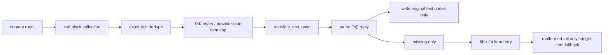

> **HISTORICAL** — superseded by AI_PAGE_TRANSLATION_VNEXT.md; kept for archaeology.

# AI 페이지 번역 Lite

> **역사 문서 — production source of truth가 아님.** Lite의 collector/packet 정책은 현재
> cloud runtime 계약이 아니다. 현재 `auto`/default는
> [vNext 운영 계약](./AI_PAGE_TRANSLATION_VNEXT.md), 명시적 rollback은
> [stable 계약](./AI_PAGE_TRANSLATION_STABLE.md)을 따른다.
>
> 기준일: 2026-07-13 · 대상: OpenAI, Google AI Studio, OpenAI-compatible

## 목적

Lite는 Google 페이지 번역의 실행 형태를 LLM에 맞게 단순화한 경로다. Google의 전용 번역
backend 자체를 복제하는 것은 아니다. 대신 확장 쪽에서 검증 가능한 네 가지 원칙만 따른다.

1. DOM을 블록 단위로 한 번 수집한다.
2. 레이아웃 HTML 대신 텍스트와 안전한 인라인 태그만 보낸다.
3. 여러 블록을 큰 패킷으로 묶고, 응답은 원본 DOM의 텍스트 노드에만 쓴다.
4. 실패해도 전체를 다시 보내지 않고 누락된 블록만 단계적으로 복구한다.

사이트별 selector나 위키 전용 분기는 없다. 표준 block element, `translate=no`,
`.notranslate`, ARIA/hidden 의미와 `title`, `placeholder`, `aria-label`, `alt`만 사용한다.

## 기본 흐름



### 수집과 제외

-   문단, 제목, 목록 항목, 표 셀, caption, label, button 같은 표준 leaf block을 문서 순서로 수집한다.
-   `translate=no`, `.notranslate`, `aria-hidden=true`, `hidden`, `inert`, script/style/template는 제외한다.
-   기본 smart filter는 표준 ARIA/DOM 의미로 references, footnote, TOC, nav apparatus를 제외한다.
-   block payload는 구조 tag와 속성을 제거하고 문장 흐름에 필요한 안전한 inline tag만 남긴다.
-   같은 source 문자열은 본문과 접근성 속성에 여러 번 나타나도 한 번만 생성한다.
-   보이는 본문이 있는 요소의 tooltip은 보내지 않고, input/media처럼 본문이 없는 속성만 번역한다.

### 패킹

-   첫 요청: 최대 18,000 chars, Gemini 96 또는 OpenAI 128 unique segment
-   누락 재시도: 최대 6,000 chars 또는 24 segment
-   형식 누락이 다시 발생하면 해당 꼬리만 1개씩 마지막 안전 번역
-   cloud 요청 동시성: 최대 4 (`openaiCompatible` 기본 2)
-   viewport 측정, 화면 근처 우선순위, scroll 대기는 없다. 전체 문서를 처음부터 문서 순서로 패킹한다.

18K는 Google 번역 bundle에서 관찰되는 약 30KB request보다 보수적이다. LLM은 번역 출력도
context/output 한도에 포함되므로 Google과 같은 30KB를 그대로 쓰면 output truncation 위험이 커진다.

### 적용 안전성

-   live DOM element를 교체하지 않는다.
-   LLM이 돌려준 inline HTML은 기존 sanitizer를 통과시킨다.
-   원본 element의 text node value만 갱신한다.
-   속성 번역은 임시 element의 `textContent`로 markup을 제거한 뒤 기록한다.
-   source echo, 빈 segment, 누락 marker는 적용하지 않는다.

### 실패와 토큰 상한

-   정상 응답에서 빠진 segment만 최대 24개씩 다시 요청한다.
-   두 번째 응답도 성공했지만 marker 형식만 불완전하면 남은 꼬리를 1개씩 안전 번역한다.
-   provider/transport/rate-limit 실패는 1개씩 증폭하지 않고 해당 retry 단계에서 종료한다.
-   모든 recovery 요청의 보수 추정치도 같은 hard-budget 창에 예약한다. 무한 분할이나 coverage sweep은 없다.
-   기본 hard budget은 24,000 total-token 추정 창이다. 다음 packet이 창을 넘으면 요청 전에 멈추고
    배너의 `Continue`로 새 창을 연다.
-   provider usage가 있으면 실제 input/output/reasoning 합계를 표시하고, 없을 때만 보수 추정치에 `~`를 붙인다.

## 동적 페이지

MutationObserver는 child/text/번역 대상 속성 변경만 모은다. 전체 문서를 다시 scan하지 않고 변경된
leaf block만 수집한다. 적용 직후 observer가 같은 번역을 다시 잡지 않도록 element별 마지막 값도
기억한다. 번역 도중 새 block이 추가되면 현재 batch가 끝난 직후 새 packet으로 이어서 처리한다.

## 라우팅과 rollback

| 설정             | 경로                              |
| ---------------- | --------------------------------- |
| `auto`           | Google-style continuous (새 기본) |
| `v1`             | 기존 `seg-v6-semantic` 경로       |
| `v2`             | structured V2 preview             |
| Chrome on-device | 기존 V1 경로                      |

Lite 소스는 구현 이력과 비교 테스트용으로 남아 있으며 현재 설정에서 직접 선택되지 않는다. 기본 경로에
문제가 있으면 설정에서 V1을 선택할 수 있다. V2의 provider capability/strict schema 연구 코드는
preview로 유지하지만 기본 요청에는 관여하지 않는다.

## 검증

```bash
npm test -w edge_translate -- --runInBand \
  test/unit/content/aiPageTranslationLiteSession.test.js

npm run bench:ai-page:lite -- \
  --url=https://ja.wikipedia.org/wiki/%E4%BA%AC%E9%98%AA%E6%9C%AC%E7%B7%9A
```

benchmark는 provider를 호출하지 않는다. unique block/attribute 수, 실제 packet 수, payload chars와
client token 예약 추정만 출력한다. 비용·번역 품질을 주장하려면 별도의 provider 실측이 필요하다.

2026-07-13 京阪本線 server HTML 구조 측정에서는 초기 단순 수집이 2,592 unique segment,
28 packet, 133,888 reserved-token 추정이었다. generic apparatus/attribute 정책과 provider-safe
packing 적용 후 Gemini 기준 1,646 segment, 18 packet, 104,908 추정으로 줄었다. 4-way 병렬 처리라
정상 경로는 약 5 request wave이고, 이전 192-item/2-way의 약 5 wave와 비슷한 지연에서 marker
누락 위험을 낮춘다. 이 값은 실제 provider 사용량이 아니며, viewport gating 없이 긴 문서 전체를
생성하는 이상 출력 토큰이 계속 가장 큰 하한이다.
