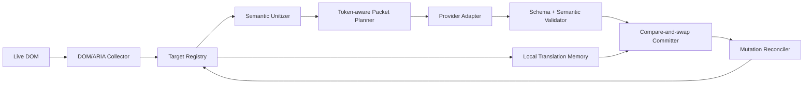

> **HISTORICAL** — superseded by AI_PAGE_TRANSLATION_VNEXT.md; kept for archaeology.

# AI 페이지 번역 V2 설계서

> **역사 설계 문서 — production source of truth가 아님.** 이 문서의 V2 preview, viewport
> scheduling, token budget, migration 단계는 현재 동작을 설명하지 않는다. 현재 cloud
> `auto`/default 구현은 [vNext 운영 계약](./AI_PAGE_TRANSLATION_VNEXT.md), rollback은
> [stable 계약](./AI_PAGE_TRANSLATION_STABLE.md)을 따른다.
>
> 기준일: 2026-07-13
>
> 대상: OpenAI, Google AI Studio(Gemini), OpenAI-compatible
>
> 관련 문서: [현재 vNext 구현 계약](./AI_PAGE_TRANSLATION_VNEXT.md),
> [개발 가이드](./DEVELOPMENT_GUIDE.md),
> [V2 POC·벤치마크 명세](./AI_PAGE_TRANSLATION_V2_BENCHMARK.md)

이 문서는 현행 `seg-v6-semantic` 파이프라인을 부분 수정하는 문서가 아니다. 현행 구현과
나란히 동작하는 새 파이프라인을 만들기 위한 계약서다. 구현 중 해석이 갈리면 이 문서의
소유권 경계, 불변식, 상태 전이, 실패 정책을 우선한다. 아직 측정하지 않은 처리량·청크 크기·
품질 수치는 임의로 확정하지 않고 POC 결과로 결정한다.

### 현재 구현 상태

2026-07-13 기준 V2는 content -> background -> provider adapter까지 명시적 preview 경로로
연결됐다. 이 문서의 초기 구현 당시 `pipelineVersion="auto"`는 Lite였지만, 2026-07-13 이후 기본값은
Google-style continuous 경로이고 `"v2"`만 V2를 선택한다.
실제 OpenAI/Gemini로 P1·P2 단일 실측과 복잡 페이지 P5 smoke는 통과했지만 반복 품질 평가와
저장 snapshot V1/V2 P6 비교 전에는 auto를 V2로 바꾸지 않는다. 설정 화면의
`AI 페이지 번역 파이프라인`에서 V2 preview를 명시적으로 켜고,
문제가 있으면 V1을 즉시 강제할 수 있다.

Chrome on-device AI는 background provider adapter 계약과 실행 위치가 다르므로 현재 V2 preview
라우팅 대상이 아니며 기존 V1 경로를 유지한다. 별도 main-world adapter와 usage/budget 계약을
정의하기 전에는 cloud V2 profile로 가장하지 않는다.

-   JSON-only packet request/reply 계약과 ID 격리 검증
-   session-local Target Registry와 명시적 상태 전이
-   `Text.data`/허용 attribute 전용 compare-and-swap committer와 안전 복원
-   기존 V1의 viewport tier, 2.5-screen lazy window, eager token budget,
    `prefetchScreens=0` 의미를 보존하는 pure admission module
-   array-fixed / array-exact / ID-object 구조 오버헤드를 비교하는 offline runner
-   사이트 selector 없는 DOM/ARIA collector와 table/list/inline semantic unitizer
-   capability 기반 input/output/combined 제한과 25% input, 15% output 예약 여유를 쓰는 planner
-   OpenAI Responses, Gemini generateContent, OpenAI-compatible 단일시도 adapter
-   provider usage provenance와 billing-event 중복 제거를 포함한 hard token ledger
-   validated tail만 최대 한 세대 재시도하는 bounded scheduler
-   source 원문까지 검증하는 model/language/role별 persistent translation cache
-   source+role 세션 dedupe, URL/숫자/식별자 보존, source echo/목표 script/길이 검증
-   실제 `AbortController`, profile revision, inflight join/replay 0회 과금 transport
-   불변 `SessionSnapshot` -> 기존 banner 표시 adapter
-   `auto -> Lite`, 명시적 `v2 -> V2`, `v1 -> V1` rollback router
-   generic MutationObserver와 open shadow root 관찰을 통한 SPA 추가/수정 target 재수집
-   실제 build를 Chrome for Testing에 로드하는 local HTTP E2E: 182 target을 4 requests로 처리,
    provider token/request 배너 일치, DOM/SPA invariant 보존
-   `--confirm-provider-cost`, hard run budget, token-count preflight, packet별 단일 generation,
    append-only NDJSON 원장을 강제하는 실제 provider P1/P2 runner
-   실제 P1에서 두 provider 모두 array-exact 100% mapping, P2 160-target packet curve 100% coverage
-   실제 京阪本線 Chrome P5에서 OpenAI 1,023 target/4 requests/14K, Gemini
    1,023 target/5 requests/17K, extension runtime exception 0
-   capability metadata가 커도 요청당 target 수를 제한하는 provider protocol ceiling
-   hard budget 도달 시 자동 중단하고 배너의 `Continue` 명시적 동작으로만 다음 budget window를
    여는 단계적 전체 번역

남은 release gate는 provider별 반복·사람 품질 평가, 저장된 복잡 페이지의 재현 가능한 P5,
V1/V2 opt-in shadow 비교다. 공개 live page의 현재 화면 범위 smoke는 통과했고 hard budget 뒤
나머지는 사용자가 배너의 `Continue`로 다음 budget window를 명시적으로 승인해 이어간다.

## 1. 결론

V2의 핵심은 다음 한 문장이다.

> 확장이 DOM과 작업 상태를 소유하고, LLM은 구조화된 텍스트 배열만 번역한다.

전체 HTML을 모델에 보내거나 번역된 HTML을 다시 삽입하지 않는다. HTML 통째 전송은 요청
수를 줄여 보일 수 있지만 실제로는 태그·속성·URL·숨은 노드 토큰, 큰 출력, 전체 실패 범위,
DOM 재생성 위험을 함께 만든다. V2는 페이지를 번역 가능한 target으로 수집하고, 가까운
target을 semantic unit으로 묶은 뒤, 공급자별 토큰 한도에 맞는 packet으로 보낸다.



## 2. 전면 재작성의 이유

현행 구현에는 재사용할 자산이 많지만, orchestration 책임이
`packages/EdgeTranslate/src/content/banner_controller.js`에 집중되어 있다. 수집, IR,
batching, streaming, provider transport, validation, retry, cache, progress UI가 한 상태 공간을
공유한다. 이 상태에서 marker 누락이나 context-size 오류 하나가 여러 보정 경로를 통과하면
요청 수와 토큰이 증폭된다.

확인된 현행 의미는 다음과 같다.

-   `Translation incomplete (N sections failed)`의 `N`은 HTTP 실패 횟수도, 실제 leaf 실패
    수도 아니다. terminal unresolved leaf를 가진 원본 logical owner 수다.
-   `AiPageTranslateConfig.tokenBudget=8000`은 전체 세션 토큰 상한이 아니라 eager 입력 추정량
    soft cap이다. 출력, reasoning, 재시도, 공급자 내부 재호출을 완전히 제한하지 않는다.
-   context-size 재귀 이분은 4개 leaf에서 `4 -> 2+2 -> 1+1+1+1`처럼 최초 1회를 포함해
    7개 요청으로 커질 수 있다.
-   배너 request 수는 content controller 호출 수이며 공급자 adapter 내부 HTTP 호환 재시도를
    모두 나타내지 못할 수 있다.
-   자유 형식 `[[n]]` 응답은 marker 보존, 순서, 번역 품질을 하나의 문자열 parser가 동시에
    판정하게 만든다.

V2는 이 문제를 더 많은 예외 처리로 덮지 않고 책임을 분리한다.

## 3. 목표와 비목표

### 3.1 목표

1. 같은 source target을 한 세션에서 두 번 과금하지 않는다.
2. validated target은 어떤 재시도에도 다시 포함하지 않는다.
3. 공급자 호출 횟수와 실제 usage를 요청 단위 ledger에 남긴다.
4. DOM 구조, listener, focus, selection, form state를 보존한다.
5. 첫 화면을 먼저 번역하고, 기존 `lazyTranslate`/viewport 기반 입장 정책을 유지한다.
6. 표, 목록, 문서, 대시보드, SPA처럼 구조가 다른 페이지를 사이트 하드코딩 없이 처리한다.
7. 한 packet 실패를 페이지 전체 실패로 확대하지 않는다.
8. 전체 사용량 hard guard가 input/output/reasoning과 모든 attempt를 포함한다.
9. 공급자별 기능 차이는 model 이름 정규식이 아니라 capability로 결정한다.
10. 사용자에게 `실패한 section 수` 대신 실제 상태와 원인을 보여 준다.

### 3.2 비목표

-   모델이 HTML, CSS, DOM tree 또는 event handler를 재생성하게 하지 않는다.
-   모든 페이지를 처음부터 끝까지 무조건 선번역하지 않는다.
-   provider Batch API를 실시간 페이지 번역 경로에 쓰지 않는다.
-   prompt cache를 번역 메모리의 대체재로 쓰지 않는다.
-   한 모델의 최대 context window를 packet 목표 크기로 쓰지 않는다.
-   번역 품질을 round-trip 번역 하나로 판정하지 않는다.
-   closed shadow root나 권한 없는 cross-origin frame을 실패로 세지 않는다.

## 4. 반드시 지킬 불변식

다음 조건은 성능과 교환하지 않는다.

| ID   | 불변식                                                                                   |
| ---- | ---------------------------------------------------------------------------------------- |
| I-01 | LLM 출력으로 `innerHTML`, `outerHTML`, Element 단위 `textContent`를 설정하지 않는다.     |
| I-02 | Text target은 캡처한 `Text.data`가 그대로일 때만 적용한다.                               |
| I-03 | Attribute target은 캡처한 attribute 값이 그대로일 때만 적용한다.                         |
| I-04 | 응답의 schema와 의미 검증이 끝나기 전에는 DOM에 적용하지 않는다.                         |
| I-05 | 요청 target 집합과 응답 target 집합의 대응이 증명되지 않으면 적용하지 않는다.            |
| I-06 | validated/applied target은 retry packet에 다시 넣지 않는다.                              |
| I-07 | 하나의 HTTP attempt는 ledger에 정확히 하나의 terminal record를 남긴다.                   |
| I-08 | retry 소유자는 session scheduler 한 곳뿐이다. provider adapter는 자동 재시도하지 않는다. |
| I-09 | budget 예약이 되지 않은 packet은 전송하지 않는다.                                        |
| I-10 | session/revision이 바뀐 응답은 `stale`이며 번역 실패가 아니다.                           |
| I-11 | cache hit와 inflight joiner는 과거 provider usage를 다시 청구하지 않는다.                |
| I-12 | 공급자 usage의 subset 필드(cache/reasoning)를 total에 중복 합산하지 않는다.              |

## 5. 범용 DOM 수집 계약

### 5.1 target 종류

V2의 최소 적용 단위는 `TranslationTarget`이다.

```ts
type TranslationTarget = {
    id: string;
    sessionId: string;
    revision: number;
    kind: "text" | "attribute";
    nodeRef: WeakRef<Text | Element>;
    attributeName?: string;
    source: string;
    normalizedSource: string;
    sourceHash: string;
    role: string;
    sourceLanguage: string;
    targetLanguage: string;
    context: TargetContext;
    priority: "visible" | "prefetch" | "deferred";
    state: TargetState;
};
```

`id`는 세션 안에서만 안정적이면 된다. persistent cache는 DOM 경로나 target ID가 아니라
정규화된 source와 언어·role·policy signature를 사용한다.

### 5.2 번역 대상

-   의미 있는 Text node
-   `alt`, `title`, `placeholder`
-   `option`, `optgroup`, `track`의 `label`
-   버튼 역할을 하는 일부 `input.value`
-   직접 문자열을 가진 `aria-label`, `aria-description`, `aria-placeholder`,
    `aria-roledescription`, `aria-valuetext`

다음은 번역하지 않는다.

-   `translate="no"`가 적용되는 subtree
-   `script`, `style`, `noscript`, `template`, 코드·수식 보존 영역
-   password/hidden input, 현재 사용자가 편집 중인 value, `contenteditable`
-   `aria-labelledby`, `aria-describedby`, `aria-controls`, `aria-owns` 같은 ID reference
-   URL, `href`, `src`, class, style, `data-*`, event attribute
-   확장 자체 UI
-   접근할 수 없는 closed shadow root

`aria-labelledby`가 가리키는 실제 Text node를 번역하면 accessible name도 함께 바뀐다.
ID reference 자체를 번역해서는 안 된다.

### 5.3 수집 범위와 우선순위

수집과 번역 입장은 분리한다.

-   collector는 접근 가능한 eligible target을 registry에 등록한다.
-   admission policy는 기존 `AiPageTranslateConfig.lazyTranslate`, viewport 거리,
    `prefetchScreens`를 사용해 지금 전송할 target을 고른다.
-   `skipBoilerplate`와 `smartContentFilter`는 site selector가 아니라 HTML/ARIA 구조,
    반복 밀도, link/text 비율 같은 일반 신호만 사용할 수 있다.
-   숨겨졌다가 표시되는 eligible target은 Mutation/Intersection 경로에서 다시 입장한다.

이 설계는 “보는 위치에 따라 번역”을 새로 만드는 것이 아니다. 이미 존재하는 제품 옵션을
V2 scheduler의 admission policy로 재사용한다.

다만 현행 `selectAiPageEntriesForLazyWindow()`, backlog, reveal 메서드를 V2가 직접 호출하지
않는다. 이 메서드들은 V1의 `entry.section`, `_untranslatedChildren`, gap candidate, retry/cache
상태와 결합되어 있다. viewport 계산과 설정 의미를 다음 pure contract로 추출해 V1/V2가
공유한다.

```ts
type AdmissionItem = {
    id: string;
    anchor: Element;
    estimatedInputTokens: number;
};
```

기존 lazy 테스트 벡터를 공용 `viewport_admission` 테스트로 복제해 V1과 V2의 visible/prefetch/
deferred 판정이 같음을 증명한다.

### 5.4 shadow DOM과 frame

-   open shadow root는 별도 root로 등록해 같은 collector를 재사용한다.
-   closed shadow root는 `inaccessible` coverage로 기록하고 실패에서 제외한다.
-   same-origin frame은 권한과 content-script 주입 범위가 확인될 때 독립 session child로 처리한다.
-   cross-origin frame은 해당 origin 권한이 없으면 `out_of_scope`다.
-   frame 결과를 부모 DOM target ID와 섞지 않는다.

## 6. Registry와 상태 모델

```text
discovered
  -> cached -> validated -> applied
  -> queued -> in_flight -> validated -> applied
                         -> retry_wait -> queued
                         -> failed_terminal
  -> skipped_policy
  -> stale
  -> canceled
```

허용 규칙:

-   `applied`는 schema, mapping, semantic validation을 통과한 target만 가능하다.
-   DOM 값이 request 중 바뀌면 `stale`로 끝내고 새 revision을 별도 target으로 수집한다.
-   `failed_terminal`은 동일 payload 재시도 한도를 소진했을 때만 가능하다.
-   `skipped_policy`, `inaccessible`, `out_of_scope`는 실패율 분모와 별도로 보고한다.
-   session 취소는 pending fetch를 abort하고 `queued/in_flight/retry_wait`를 `canceled`로 바꾼다.

Registry가 target 상태의 유일한 소유자다. WeakSet, entry flag, retry counter에 같은 의미를
분산하지 않는다.

## 7. Semantic Unit

`SemanticUnit`은 모델이 문맥을 함께 볼 단위이고 DOM 적용 단위와 다르다.

```ts
type SemanticUnit = {
    id: string;
    targetIds: string[];
    sourceItems: string[];
    role: "paragraph" | "heading" | "list" | "table-row" | "label" | string;
    context?: {
        heading?: string;
        parentLabel?: string;
        columnHeaders?: string[];
        listPosition?: [number, number];
    };
    protectedTokens?: string[];
};
```

현재 구현에서 packet planner의 패킹 단위는 `SemanticUnit`이지만 provider wire의 결과 단위는
atomic DOM target이다. 각 target은 semantic unit ID/kind/position/context를 함께 받아 문맥을
공유한다. 이 선택은 한 row/list를 한 문자열로 합친 뒤 다시 분해하는 모호성을 없애고,
부분 응답에서 검증된 target만 즉시 적용하기 위한 것이다. packet-local base36 alias가 긴 target
ID 반복 비용을 줄인다. 향후 grouped-output 프로토콜은 constituent 경계 검증을 증명한 뒤에만
추가한다.

일반 규칙:

-   같은 문단의 inline text는 함께 본다.
-   표는 전체 table이 아니라 column header + 제한된 인접 row 묶음으로 나눈다.
-   목록은 전체 거대 list가 아니라 인접 item 묶음으로 나눈다.
-   heading은 뒤따르는 가까운 문단의 선택적 context가 될 수 있지만 번역 결과 target과
    context를 혼동하지 않는다.
-   context는 source 본문보다 커지지 않게 중복 제거하고 packet마다 제한한다.
-   동일한 context를 모든 packet에 반복하지 않는다. 필요한 unit에만 넣는다.

### 7.1 inline 경계

하나의 leaf가 링크·강조 등 여러 Text node로 나뉘면 구조를 재생성하지 않고 로컬
placeholder를 쓴다. placeholder는 packet item 안에서만 유효하며 global `[[n]]` marker가
아니다.

```text
Read <x0>the release notes</x0> before upgrading.
```

응답에서 placeholder의 개수, 이름, nesting을 검증한다. 실패하면 그 unit만 target part
형태로 한 번 낮춰 재시도한다. 이미 성공한 다른 unit이나 page packet은 다시 보내지 않는다.

## 8. 모델 입출력 프로토콜

### 8.1 기본 원칙

-   system instruction은 고정하고 page data는 마지막 user payload에 둔다.
-   페이지의 문자열은 명령이 아니라 번역할 데이터라고 명시한다.
-   출력은 공급자의 strict Structured Output을 우선한다.
-   HTML이나 자유 형식 marker stream을 정상 경로로 사용하지 않는다.
-   V2 POC는 아래 두 계약을 같은 corpus에서 비교한다.

### 8.2 후보 A: 순서 기반 string array

입력:

```json
{ "s": ["京阪本線", "駅番号はKH01です。", "運行形態"] }
```

출력:

```json
{ "t": ["게이한 본선", "역 번호는 KH01이야.", "운행 형태"] }
```

검증:

-   `t.length === s.length`
-   각 index의 source와 result를 하나의 unit으로 매핑
-   모든 원소가 문자열
-   protected token 불변식 통과
-   empty/source echo/길이 폭증/목표 언어 검사를 item별 수행

장점은 ID echo가 없어 output token이 작다는 점이다. 단점은 item 하나가 누락되면 index
mapping 전체를 신뢰할 수 없다는 점이다. 그래서 exact length가 보장되지 않으면 packet을
적용하지 않고, 실패한 packet의 target만 더 작은 packet으로 한 번 보낸다.

길이만 같다고 mapping이 증명되는 것은 아니다. 모델이 중간 item 하나를 빼고 다른 item을
복제하면 array 길이는 같아도 뒤 index가 잘못된 DOM target에 적용될 수 있다. POC는 이
`drop-one + duplicate-one` fault를 반드시 주입하고 `wrong_target_apply=0`을 증명해야 한다.

Structured Output schema에 packet별 `minItems=maxItems=N`을 넣는 방식과 고정 schema 뒤
클라이언트에서 N을 검사하는 방식을 함께 측정한다. 동적 schema는 mapping 보장이 강하지만
고정 prompt prefix cache 재사용에는 불리할 수 있다.

### 8.3 후보 B: ID 기반 object array

입력:

```json
{
    "items": [
        { "id": "a", "s": "京阪本線" },
        { "id": "b", "s": "運行形態" }
    ]
}
```

출력:

```json
{
    "items": [
        { "id": "a", "t": "게이한 본선" },
        { "id": "b", "t": "운행 형태" }
    ]
}
```

검증:

-   expected ID마다 unique result가 최대 하나인지 확인
-   duplicate ID의 결과는 해당 ID 전체를 거부
-   unknown ID는 적용하지 않고 protocol violation으로 기록
-   missing ID만 unresolved로 유지
-   각 `t`가 문자열이며 item semantic validation 통과

장점은 순서 변화에 강하고 실패 item을 명시하기 쉽다는 점이다. 단점은 입력과 출력에서
ID와 key를 반복해 토큰이 늘어난다는 점이다. 반면 unique expected ID의 결과는 다른 item이
누락되거나 reorder되어도 mapping이 증명되므로 안전하게 부분 적용할 수 있다. retry에는
missing/duplicate/semantic-failed ID만 포함한다.

provider wire에는 persistent target ID를 그대로 반복하지 않는다. adapter가 packet 안에서만
유효한 짧은 base36 alias(`0..z..`)와 compact key를 만들고, 검증 후 content/background wire의
원래 unit ID로 되돌린다. alias map은 로컬에만 남고 모델이 새 ID를 만들게 하지 않는다.

### 8.4 프로토콜 결정 규칙

선호만으로 A를 채택하지 않는다. 다음 순서로 결정한다.

1. schema/mapping 오류가 하나라도 있으면 해당 후보는 탈락한다.
2. 두 후보가 모두 100% mapping을 만족하면 total provider tokens가 적은 후보를 고른다.
3. token 차이가 작으면 first-visible latency와 번역 품질이 좋은 후보를 고른다.
4. 공급자별 결과가 다르면 하나의 wire format을 억지로 강제하지 않고 adapter capability로
   선택하되, registry/result 의미는 동일하게 유지한다.

## 9. Packet planner

### 9.1 입력

```ts
type PacketPlanInput = {
    units: SemanticUnit[];
    providerCapabilities: ProviderCapabilities;
    budgetSnapshot: BudgetSnapshot;
    viewportPriority: Map<string, number>;
    translationPolicy: TranslationPolicy;
};
```

planner는 문자 수가 아니라 다음 값을 함께 사용한다.

-   실제 또는 추정 input tokens
-   target 언어별 예상 output expansion
-   schema/고정 prompt overhead
-   모델의 maximum output tokens
-   context window
-   packet item 수
-   protected token 수와 unit 복잡도
-   현재 rate-limit/concurrency 상태

정확한 preflight token API는 모든 작은 요청에 호출하지 않는다. 로컬 tokenizer/추정으로
여유가 충분한 packet은 바로 보내고, 큰 packet 또는 한계 근처 packet에만 사용한다.

### 9.2 packet 크기

고정 `122개`, `8K`, `80% of context` 같은 숫자를 설계 상수로 두지 않는다. planner는
capability와 실측에 따라 target ceiling을 계산한다.

```text
estimatedTotal = input + expectedOutput + expectedReasoning + protocolOverhead
sendable =
  input <= capability.safeInput &&
  expectedOutput <= capability.safeOutput &&
  budget.canReserve(worstCaseTotal)
```

`safeInput`과 `safeOutput`은 model maximum과 같은 값이 아니다. POC의 truncation, latency,
quality curve에서 결정한다.

### 9.3 우선순위와 동시성

1. visible target을 작은 lead packet으로 보낸다.
2. viewport prefetch horizon 안의 packet을 보낸다.
3. 기존 lazy policy에 따라 나머지는 deferred 상태로 둔다.
4. viewport가 이동하면 deferred packet을 새 위치 기준으로 재계획한다.
5. rate limit header, latency EMA, 429를 바탕으로 concurrency를 줄인다.
6. 동일 packet을 더 높은 concurrency로 재생성하지 않는다.

첫 POC는 작은 packet 단위 non-streaming을 기본으로 한다. Structured JSON partial을 DOM에
점진 적용하지 않는다. streaming은 terminal usage 신뢰성, TTFT 이득, parser 복잡도를 측정한
뒤 별도 결정한다.

## 10. Provider adapter 계약

```ts
type CapabilitySource =
    | "profile-override"
    | "provider-metadata"
    | "runtime-probe"
    | "runtime-observation"
    | "fallback-policy";

type Observed<T> = {
    value: T | null; // null은 unknown이며 false/0과 다르다.
    source: CapabilitySource;
    observedAt: number;
    expiresAt?: number;
};

type ProviderCapabilities = {
    apiStyle: "openai-responses" | "openai-chat" | "gemini" | "on-device";
    modelId: string; // opaque ID. 이름을 파싱해 capability를 만들지 않는다.
    structuredOutput: Observed<Array<"json-schema" | "json-object" | "prompt-json">>;
    tokenCount: Observed<"remote-exact" | "local-estimate" | "none">;
    maxInputTokens: Observed<number>;
    maxOutputTokens: Observed<number>;
    reasoningControl: Observed<"effort" | "thinking-config" | "none">;
    usageMode: Observed<"final-absolute" | "cumulative" | "delta" | "none">;
    reasoningRelation: Observed<"subset-of-output" | "additional-to-output" | "unknown">;
};

interface PageTranslationProvider {
    discover(profile: ProviderProfile, signal: AbortSignal): Promise<ProviderCapabilities>;
    countInput?(request: PacketRequest): Promise<TokenCount>;
    executeOnce(request: PacketRequest, signal: AbortSignal): Promise<PacketResponse>;
    cancel(requestId: string): void;
}
```

capability의 `unknown`을 임의의 `false`나 큰 token limit로 바꾸지 않는다. fallback policy는
provider 사실이 아니라 보수적인 제품 정책임을 provenance에 남긴다.

### 10.1 OpenAI native

-   신규 V2는 Responses API를 1순위로 사용한다.
-   `text.format`의 strict Structured Output을 사용한다.
-   `truncation`은 자동 누락을 피하기 위해 disabled로 둔다.
-   큰/경계 packet만 `/v1/responses/input_tokens`로 preflight한다.
-   reasoning은 번역에 필요한 최소 설정을 capability가 허용하는 범위에서 사용한다.
-   prompt cache는 고정 instruction/schema prefix만 명시적으로 대상으로 삼는 실험을 한다.
    일회성 page body는 기본 cache 대상이 아니다.

### 10.2 Google AI Studio

-   Structured Output JSON schema를 사용한다.
-   큰/경계 packet만 `count_tokens`를 호출한다.
-   thinking은 지원 범위에서 disabled/minimal부터 검증한다.
-   usage의 prompt, candidate, thoughts, cached, total 의미를 보존한다.
-   Interactions/GenerateContent 중 실제 extension 요구와 안정성에 맞는 API를 POC에서 고른다.

### 10.3 OpenAI-compatible

-   `/v1/chat/completions` 호환만 가정하고 Responses/strict schema를 가정하지 않는다.
-   endpoint가 지원한다고 선언하거나 probe가 성공한 기능만 사용한다.
-   JSON-only fallback도 mapping/semantic validator를 동일하게 통과해야 한다.
-   structured output이 없는 모델은 작은 packet으로 제한하고 별도 compatibility protocol을
    사용한다. 자유 형식 marker를 V2의 보편 기본값으로 되살리지 않는다.
-   `apiFlavor: responses | chat | auto` profile을 둔다. `auto`에서 Responses endpoint가
    404/405/501처럼 명시적으로 미지원일 때만 Chat으로 낮춘다. auth, rate-limit, 5xx,
    model-not-found를 protocol 미지원으로 오해해 다른 endpoint로 재호출하지 않는다.

### 10.4 Chrome on-device

-   cloud와 같은 registry/result 계약을 사용하되 작은 packet과 낮은 concurrency를 쓴다.
-   browser API availability와 language pair 지원 여부를 runtime capability로 본다.
-   on-device 실패를 cloud provider로 자동 전환하려면 사용자 설정과 privacy 경계를 먼저
    확인해야 하며, 암묵적으로 외부 전송하지 않는다.

### 10.5 retry 소유권

adapter의 `executeOnce`는 HTTP 요청을 정확히 한 번 수행한다. SDK나 helper의 자동 retry도
끄거나 attempt ledger에 노출해야 한다. retry 판단과 새 packet 생성은 scheduler만 한다.

adapter가 내보내는 stream event는 raw 누적 문자열이 아니라 `text-delta`, `usage-snapshot`,
`finish` 같은 provider-neutral event다. content로 진행 상황을 보낼 필요가 있으면 완전히
검증된 unit만 `validated-units` event로 보낸다.

content에서 cancel하면 단순히 stale apply만 막아서는 안 된다. background transport는
`${tabId}:${sessionId}:${packetId}`별 `AbortController`를 보관하고 다음 취소 계약으로 실제
provider 요청을 중단한다. 그렇지 않으면 배너를 닫은 뒤에도 output token이 계속 발생한다.

```text
cancel_page_translation_v2
{ sessionId, packetIds, reason }
```

## 11. 모델 자동 갱신과 capability discovery

모델 목록 자동 갱신과 모델 기능 판정은 별개다.

-   기존 `model_catalog.js`의 provider `/models` 조회, API-key fingerprint cache, TTL, 수동
    refresh 개념은 재사용한다.
-   catalog item을 단순 string에서 `{id, displayName, providerMetadata, capabilityState}`로 확장한다.
-   Google model metadata가 제공하는 token limit와 supported methods는 저장한다.
-   OpenAI `/models`가 번역·Structured Output 지원 여부를 충분히 설명한다고 가정하지 않는다.
-   선택된 model은 첫 실제 사용 전 저비용 capability probe 또는 명확한 provider 오류로
    기능을 협상하고 결과를 TTL cache한다.
-   capability 우선순위는 `profile override -> provider metadata -> runtime probe/observation -> conservative fallback policy`다.
-   model 이름 regex는 display 정렬이나 임시 fallback에만 사용할 수 있고 capability의 권위
    있는 근거가 될 수 없다.

OpenAI-compatible capability cache는 `protocol | normalizedOrigin | apiVersion | modelId | profileRevision | serverFingerprint`로 구분한다. API key 원문이나 hash를 capability cache에
저장하지 않는다. auth/quota 오류는 capability로 학습하지 않고, 명시적인 unsupported 응답만
짧은 negative cache로 저장한다.

자동 목록에 나타났다는 이유만으로 페이지 번역 가능 모델로 표시하지 않는다. 확인 전에는
`미검증`, 성공 후 `구조화 페이지 번역 지원`, 실패 후 구체적인 미지원 이유를 표시한다.

## 12. 검증과 DOM commit

### 12.1 schema validation

-   JSON parse 성공
-   schema 일치

### 12.2 mapping validation

-   array protocol은 exact length가 아니면 packet 전체 미적용
-   ID protocol은 unique expected ID만 적용 가능
-   duplicate expected ID는 해당 ID 전체 거부
-   unknown ID는 적용하지 않고 protocol violation 기록
-   missing ID는 unresolved로 유지

### 12.3 semantic validation

-   protected token set과 nesting 보존
-   source echo가 허용되는 target인지 판정
-   목표 언어 script/언어 신호
-   URL, 숫자, 단위, 코드 token 보존
-   비정상 길이 축소/폭증
-   prompt나 schema echo 없음

언어 검사는 짧은 고유명, 역명, 코드에 과도하게 적용하지 않는다. `keep-source`가 합법인
조건을 별도 classifier로 정의하고, 단순히 원문과 같다는 이유로 실패시키지 않는다.

### 12.4 compare-and-swap 적용

```text
if !node.isConnected: stale
if currentValue !== capturedSource: stale
write translatedValue
remember appliedTranslation
```

복원도 `currentValue === appliedTranslation`일 때만 source를 쓴다. 사이트가 번역 후 값을
바꿨다면 사이트 값을 보존한다.

## 13. 실패와 재시도 정책

| 분류                          | 처리                                                                          | 최대 추가 attempt |
| ----------------------------- | ----------------------------------------------------------------------------- | ----------------: |
| 429/5xx/network               | queue 전체 pause, `Retry-After`/jitter backoff, 같은 unresolved target 재전송 |                 1 |
| context/input/output size     | planner ceiling 하향, 해당 packet만 한 번 더 작은 packet으로 재계획           |                 1 |
| schema 오류                   | packet 전체 미적용, 해당 target만 더 작은 packet으로 재계획                   |                 1 |
| array mapping 오류            | packet 전체 미적용, 더 작은 packet으로 재계획                                 |                 1 |
| ID mapping 오류               | unique valid ID는 적용, missing/duplicate ID만 재계획                         |                 1 |
| item semantic 오류            | 성공 item 적용, 실패 item만 더 작은 packet으로 재계획                         |                 1 |
| placeholder 오류              | 해당 unit을 target-part fallback으로 한 번 재계획                             |                 1 |
| refusal/content filter/safety | 동일 payload 재시도 금지, 원문 유지, 구체적 reason                            |                 0 |
| auth/billing/model not found  | session pause, 사용자 조치 필요                                               |                 0 |
| DOM revision 변경             | `stale`, 새 revision collector가 담당                                         |                 0 |
| user cancel/navigation        | `canceled`                                                                    |                 0 |

재귀 이분은 사용하지 않는다. 첫 재계획도 original packet의 실패 target만 포함하며, 한 번 더
실패하면 terminal로 끝낸다. “coverage sweep”은 terminal target을 같은 세션에서 다시 살리지
않는다.

## 14. Token Budget Ledger

### 14.1 목적

현행 입력 soft cap과 별개로 실제 세션 hard guard를 둔다.

```ts
type UsageField = {
    value: number;
    source: "provider-reported" | "provider-counted" | "client-estimated";
};

type UsageReceipt = {
    billingEventId: string;
    requestId: string;
    attemptId: string;
    coverage: "complete" | "partial" | "unknown";
    inputTokens?: UsageField;
    outputTokens?: UsageField;
    reasoningTokens?: UsageField;
    cachedInputTokens?: UsageField;
    cacheWriteTokens?: UsageField;
    totalTokens?: UsageField;
    reasoningRelation: "subset-of-output" | "additional-to-output" | "unknown";
};
```

합산 규칙:

-   request `totalTokens`가 있으면 그 값을 session total에 더한다.
-   없으면 `reasoningRelation`이 알려진 경우에만 중복 없이 total을 계산한다. relation이
    unknown이면 정확한 total을 만들지 않고 `usage incomplete`로 표시한다.
-   cached input은 input의 부분집합이므로 다시 더하지 않는다.
-   OpenAI reasoning breakdown은 output의 subset으로 정규화한다.
-   Gemini thoughts는 candidate output과 별도로 total에 포함되므로 `additional-to-output`으로
    정규화한다.
-   실패 attempt와 retry attempt도 실제 usage가 있으면 모두 더한다.
-   최종 usage 없이 stream이 끊기면 정확한 수치로 표시하지 않는다.
-   cumulative/final stream usage는 마지막 snapshot 또는 단조 최대값을 사용하고 chunk마다
    더하지 않는다.
-   `billingEventId`로 receipt 중복을 제거한다.

### 14.2 전송 전 예약

```text
available = hardLimit - confirmedSpent - estimatedSpent - inFlightReserved
```

packet의 worst-case reservation이 `available`보다 크면 보내지 않는다. 완료 시 예약을 해제하고
실제 usage로 바꾼다. 따라서 여러 concurrent packet이 동시에 상한을 넘는 것을 막는다.

기존 `tokenBudget`은 V2에서 곧바로 hard total limit로 의미를 바꾸지 않는다. 기존 사용자
설정 호환을 위해 admission soft budget으로 읽고, 새 total hard limit/policy는 별도 migration과
UI 승인을 거친다. 기본 수치는 벤치마크 전에는 확정하지 않는다.

### 14.3 UI 표시

-   provider terminal usage만 있으면 정확한 값
-   필드별로 reported/counted/estimated를 보존하고, 하나라도 추정이면 `~` 표시
-   terminal usage가 유실되어 total 관계도 모르면 `usage incomplete` 표시
-   `in`, `out`, `reasoning`, `cache read/write`는 상세 tooltip에 표시
-   cache/reasoning이 subset임을 tooltip에 명시
-   request 수는 controller job이 아니라 실제 HTTP/on-device generation attempt 수

## 15. Cache와 중복 제거

### 15.1 계층

1. session target result map
2. in-flight dedupe
3. persistent translation memory
4. provider prompt/context cache는 선택적 최적화

### 15.2 key

```text
v2 | protocol | providerProfileHash | model | sourceLang | targetLang |
normalizedSourceHash | role | contextSignature | policyHash | glossaryHash
```

초기 V2는 provider profile과 model을 key에 포함한다. OpenAI-compatible은 API key를 제외한
endpoint host/path와 model fingerprint를 provider profile에 포함한다. model-independent
translation memory는 재사용률이 높지만 품질·용어 일관성 risk가 있으므로 별도 POC를 통과한
뒤에만 허용한다. V1 `seg-v6` cache는 V2가 읽지 않는다.

다음은 cache하지 않는다.

-   schema/mapping 검증 전 결과
-   safety/refusal 결과
-   stale/canceled response
-   target별 semantic validation 실패
-   raw partial stream
-   provider usage 객체

## 16. Mutation reconciliation

MutationObserver는 `childList`, `characterData`, 허용된 translatable attribute만 관찰한다.

-   확장 자신이 적용한 mutation은 commit token으로 식별해 재수집 루프를 막는다.
-   사이트가 source를 바꾸면 revision을 올리고 새 target으로 등록한다.
-   removed node의 pending request는 응답 시 stale 처리한다.
-   동일 source가 SPA에서 다시 나타나면 translation memory로 0-token 적용할 수 있다.
-   observer callback 안에서 바로 provider 요청을 만들지 않고 registry queue에만 넣는다.

## 17. 완료와 사용자 상태

동적 페이지에는 영구적인 “전체 완료”가 없을 수 있다. UI 상태를 다음처럼 분리한다.

| 상태                        | 의미                                             |
| --------------------------- | ------------------------------------------------ |
| `translating_visible`       | 현재 화면 target 처리 중                         |
| `visible_complete`          | 현재 화면 eligible target은 모두 적용/보류됨     |
| `waiting_for_scroll`        | 아래 target은 기존 lazy policy에 따라 deferred   |
| `rate_limited`              | provider cooldown 중                             |
| `budget_paused`             | hard budget 때문에 새 packet 입장 중지           |
| `complete_current_snapshot` | 현재 발견한 in-scope target 전체가 terminal 상태 |
| `needs_action`              | auth/model/billing 등 사용자 조치 필요           |
| `partial_with_reasons`      | 일부 target이 원문으로 남았고 reason별 수가 있음 |

`Translation incomplete (10 sections failed)` 같은 단일 숫자는 제거한다. 예:

```text
현재 화면 번역 완료 · 아래 내용은 스크롤할 때 번역
3개 항목 원문 유지: 안전 차단 1, 모델 형식 오류 2
토큰 예산 도달 · 계속 번역하려면 재개
```

## 18. 개인정보와 prompt injection

-   visible/eligible text와 허용된 accessibility 문자열만 외부 provider로 보낸다.
-   hidden form 값, password, 사용자가 입력 중인 값, dataset, script, URL query를 보내지 않는다.
-   페이지 문자열은 untrusted data다. system instruction을 흉내 낸 page text도 실행 명령으로
    취급하지 않는다.
-   source payload와 instruction을 API의 분리된 필드에 둔다.
-   출력은 strict schema와 target mapping을 통과해야 하므로 page text가 임의의 DOM 작업을
    지시할 수 없다.
-   debug log와 benchmark artifact에 API key나 원문 개인정보를 남기지 않는다.

## 19. 코드 배치 계획

현행 `BannerController`에 새 메서드를 계속 추가하지 않는다.

```text
packages/EdgeTranslate/src/content/ai_page_translation_v2/
  index.js
  session.js
  dom/collector.js
  dom/target_registry.js
  dom/committer.js
  dom/mutation_reconciler.js
  ir/semantic_unitizer.js
  ir/packet_planner.js
  ir/protocol_array.js
  ir/protocol_id_object.js
  runtime/scheduler.js
  runtime/viewport_admission.js
  runtime/budget_ledger.js
  runtime/failure_policy.js
  runtime/translation_memory.js
  runtime/session_snapshot.js

packages/EdgeTranslate/src/background/library/
  ai_page_translation_v2_transport.js

packages/EdgeTranslate/src/common/scripts/
  ai_page_translation_config.js
  ai_page_translation_v2_protocol.js

packages/translators/src/page_translation_v2/
  types.ts
  openai_responses.ts
  gemini.ts
  openai_compatible.ts
  usage.ts
  errors.ts
```

경계:

-   content V2는 DOM, target, packet plan, scheduler, budget, retry를 소유한다.
-   background transport는 channel과 provider credential 접근을 소유한다.
-   translator adapter는 request serialization, 단일 HTTP attempt, response/usage/error 정규화를
    소유한다.
-   banner UI는 `SessionSnapshot`만 렌더링하며 registry 내부 자료구조를 직접 읽지 않는다.

새 channel service는 `translate_page_packet_v2`처럼 selection용 `translate_text_quiet`와 분리한다.
페이지 wire contract가 selection/dictionary prompt 분기와 다시 결합되지 않게 한다.

Channel payload는 JSON 직렬화 가능한 값만 가진다. DOM node, WeakRef, AbortSignal, revision
pointer는 content registry 밖으로 보내지 않는다. content는 `engine/model`을 다시 조립하지
않고 `providerProfileId + profileRevision`을 보낸다. background가 실제 protocol/model/
capability를 resolve하고 응답에 그 snapshot을 돌려준다. request/response에는 session/packet/
item ID, 문자열, role/context, provider profile reference, normalized usage/error만 둔다.

### 19.1 현재 코드와의 정확한 seam

| 현재 위치                                                   | V2 처리                                                                 |
| ----------------------------------------------------------- | ----------------------------------------------------------------------- |
| `background/library/pageTranslate.js::translatePage()`      | `pipelineVersion`을 포함해 content로 전달                               |
| `banner_controller.js::startDomPageTranslate()`             | V1/V2 router와 `_activePagePipeline`만 보유                             |
| `settings.js::AiPageTranslateConfig`                        | 기존 lazy 관련 키 유지, `pipelineVersion:auto` 추가                     |
| `translate.js::translate_text_quiet`                        | V2에서 사용하지 않음; `translate_page_packet_v2` 별도 service           |
| `dom_page_translate_context.js` root/leaf/role 판정         | pure DOM discovery로 검증된 부분만 선택 재사용                          |
| `serializeTranslationLeaf()`/marker parser/semantic packing | V2에서 사용하지 않음                                                    |
| `applyPageSegmentToBlock()`                                 | V2에서 사용하지 않음; LLM output을 detached `innerHTML`로 파싱하기 때문 |
| `translationPersistentCache.js`                             | generic key/value DB와 batch channel만 adapter로 재사용                 |
| banner status                                               | V1 counter 직접 접근 대신 `SessionSnapshot` 렌더링 경계 추가            |

V2 committer는 새로 작성한다. 현행 helper의 이름이나 “in-place apply” 설명만 보고 재사용하면
안 된다. 구현은 captured `Text.data`/attribute를 직접 compare-and-swap하며 LLM 문자열을
HTML parser에 절대 넣지 않는다.

```ts
interface PageTranslationPipeline {
    start(): Promise<void> | void;
    cancel(reason: string): void;
    getSnapshot(): SessionSnapshot;
}
```

`BannerController`에는 `_activePagePipeline` 하나만 두고 V2 registry, retry, ledger 상태를
추가하지 않는다. banner는 pipeline snapshot만 렌더링한다.

## 20. Side-by-side migration

### Phase 0: 문서와 POC

-   프로토콜 A/B
-   provider capability probe
-   offline planner/token benchmark
-   DOM invariant fixture

### Phase 1: feature flag 기반 V2 skeleton

-   `AiPageTranslateConfig.pipelineVersion: "auto" | "v1" | "v2"`
-   현재 release는 `auto -> v1`, 실험 사용자는 명시적 `v2`
-   전환 release에서만 `auto -> v2`; 문제가 있는 사용자는 명시적 `v1` rollback
-   V2 session/controller를 별도 module로 생성
-   실제 provider 호출 없이 collector/registry/planner snapshot 비교

기본값을 곧바로 `"v1"`로 저장하지 않는다. 현재 settings default 보완 로직은 누락된 nested
값을 storage에 영속화하므로, 기존 사용자가 `v1`에 고정되어 나중에 default만 바꿔도 V2로
전환되지 않는 migration 문제가 생긴다.

### Phase 2: 한 provider의 packet transport

-   OpenAI Responses 또는 Gemini 중 POC가 먼저 통과한 경로
-   non-streaming strict output
-   retry 없음 상태에서 invariants 통과

### Phase 3: scheduler, budget, cache

-   viewport admission 재사용
-   exact usage ledger와 hard reservation
-   target-level translation memory
-   bounded retry policy

### Phase 4: provider 확대

-   다른 native provider
-   OpenAI-compatible compatibility tier
-   Chrome on-device

### Phase 5: shadow/opt-in

-   V1과 V2를 같은 fixture에서 비교
-   사용자가 명시적으로 V2를 선택하는 experimental UI
-   release gate 통과 후 기본 전환

### Phase 6: V1 제거

V2가 모든 acceptance gate를 통과하고 rollback 기간이 끝나기 전에는 다음을 삭제하지 않는다.

-   `seg-v6-semantic`
-   현행 persistent cache reader
-   기존 banner UI fallback

기본 전환 후에는 marker parser, recursive split, distributed retry state를 단계적으로 제거한다.

## 21. 재사용·폐기 목록

### 재사용

-   범용 DOM root/leaf/role 판정의 검증된 pure 부분
-   text-node/attribute compare-and-swap apply **원칙**(현행 HTML parser helper는 재사용 금지)
-   session/revision stale guard
-   persistent cache storage 기반
-   provider usage parser의 검증된 필드 매핑
-   기존 model catalog 자동 refresh UX
-   기존 `lazyTranslate`, viewport rank, IntersectionObserver, scroll fallback
-   safety 차단 시 DOM rollback 원칙

### 폐기

-   page-level `[[n]]` marker protocol
-   marker 안의 row/list JSON packing
-   recursive binary size split
-   controller/provider 양쪽에 나뉜 retry ownership
-   output-only runaway guard
-   request 수와 실제 HTTP attempt 수가 다른 accounting
-   model 이름 regex를 capability 근거로 쓰는 방식
-   raw HTML/translated HTML fallback
-   `BannerController` 안에 새 V2 상태를 직접 추가하는 방식

translator package source를 바꾸면 extension webpack은 source가 아니라
`packages/translators/dist/translators.es.js`를 참조하므로 translator build 후 extension build
순서를 지켜야 한다.

## 22. 설계 결정 기록

| 결정                              | 상태      | 근거                                               |
| --------------------------------- | --------- | -------------------------------------------------- |
| 전체 HTML 전송 금지               | 확정      | token, 출력 한계, failure blast radius, DOM 안전성 |
| DOM은 extension 소유              | 확정      | listener/state/structure 보존                      |
| strict structured output 우선     | 확정      | mapping을 자유 형식 parser와 분리                  |
| array vs ID object                | POC 대기  | 안정성 통과 후 token/latency 비교 필요             |
| non-streaming small packet 우선   | POC 기본  | terminal validation 전 DOM commit 금지             |
| retry owner는 scheduler 하나      | 확정      | 중복 재호출과 token 증폭 방지                      |
| hard total budget                 | 확정      | input-only soft cap의 사각지대 제거                |
| hard budget 기본값                | 측정 대기 | 실제 corpus/provider별 baseline 필요               |
| model auto list와 capability 분리 | 확정      | `/models` 목록만으로 기능을 증명할 수 없음         |
| provider Batch API는 실시간 제외  | 확정      | 비동기 completion window 때문                      |

## 23. 공식 근거

-   OpenAI: [Structured Outputs](https://developers.openai.com/api/docs/guides/structured-outputs),
    [Responses migration](https://developers.openai.com/api/docs/guides/migrate-to-responses),
    [token counting](https://developers.openai.com/api/docs/guides/token-counting),
    [prompt caching](https://developers.openai.com/api/docs/guides/prompt-caching),
    [Batch API](https://developers.openai.com/api/docs/guides/batch)
-   Google: [Structured Outputs](https://ai.google.dev/gemini-api/docs/structured-output),
    [token counting](https://ai.google.dev/gemini-api/docs/tokens),
    [context caching](https://ai.google.dev/gemini-api/docs/caching),
    [Batch API](https://ai.google.dev/gemini-api/docs/batch-api),
    [long context](https://ai.google.dev/gemini-api/docs/long-context)
-   Web standards: [WHATWG `translate`](https://html.spec.whatwg.org/multipage/dom.html#the-translate-attribute),
    [DOM `textContent`/CharacterData/MutationObserver](https://dom.spec.whatwg.org/),
    [WAI-ARIA](https://www.w3.org/TR/wai-aria-1.2/),
    [XLIFF 2.1](https://docs.oasis-open.org/xliff/xliff-core/v2.1/xliff-core-v2.1.html)

공식 문서는 API 기능과 제약의 근거다. “compact target IR이 HTML 통째 전송보다 이
프로젝트에 적합하다”는 결론과 구체적인 packet 정책은 이 프로젝트의 설계 판단이며,
절감률은 [벤치마크](./AI_PAGE_TRANSLATION_V2_BENCHMARK.md)로 검증해야 한다.

## 24. 구현 시작 조건

P0 기반:

-   [x] JSON-only wire request/reply와 unique-ID partial validation
-   [x] Target Registry 상태 전이와 revision reset
-   [x] HTML parser를 쓰지 않는 Text/attribute CAS commit/restore
-   [x] 기존 lazy viewport 의미를 보존하는 pure admission module
-   [x] provider 수치와 구분되는 offline protocol benchmark

Provider 연결 전 gate:

-   [x] local protocol fixture에서 array-exact/ID-object mapping 오류 0
-   [x] offline/live structural/browser smoke JSON 결과 형식 확정
-   [x] adapter별 usage 의미와 retry-free transport를 unit + real local HTTP 경로로 확인
-   [x] hard budget reservation 테스트 구현
-   [x] DOM invariant JSDOM + built-Chrome 테스트 구현
-   [x] `auto -> Lite`, 명시적 `v2`, 강제 `v1` rollback 경로 확정
-   [x] 기존 `lazyTranslate`의 viewport/admission 의미 보존 테스트 구현

실제 provider P1/P2 단일 run과 공개 페이지 P5 smoke는 통과했다. 사람 품질 반복 평가와 저장
snapshot 기반 재현 P5/P6는 별도 release gate이며 아직 체크하지 않는다. 위 체크는 전체 언어쌍의
품질이나 실제 가격 검증을 뜻하지 않는다.
