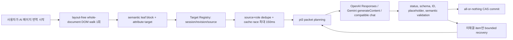

# AI 페이지 번역 vNext 운영 계약

> **Source of truth:** 이 문서는 cloud AI 페이지 번역의 현재 구현·운영 계약이다.
> 아이디어 문서나 미래 설계안이 아니다. 코드와 다르면
> `packages/EdgeTranslate/src/content/ai_page_translation/`,
> `packages/translators/src/page_translation_v2/`, 자동화 테스트 순으로 확인하고 이 문서도
> 같은 변경에서 갱신한다.

## 1. 현재 상태와 라우팅

이 변경 세트에서 cloud AI의 `pipelineVersion=auto`와 기본 요청은 vNext로 라우팅한다.
명시적인 `pipelineVersion=vnext`도 같은 경로다.

| 사용자가 고른 페이지 번역기/engine                                                  | 실제 경로                                          |
| ----------------------------------------------------------------------------------- | -------------------------------------------------- |
| `AIPageTranslate` + `openai`, `googleAiStudio`, `openaiCompatible` + `auto`/`vnext` | 이 문서의 vNext                                    |
| 같은 cloud engine + `pipelineVersion=stable`                                        | 기존 stable rollback                               |
| `chromeBuiltin`                                                                     | 기존 V1 DOM/on-device bridge                       |
| `GooglePageTranslate`                                                               | Google 스크립트 주입 경로. AI pipeline 선택과 별개 |

`DefaultPageTranslator=GooglePageTranslate`를 AI vNext 기본값 전환과 혼동하면 안 된다.
전자는 사용자가 고르는 페이지 번역기이고, 후자는 **AIPageTranslate를 선택했을 때 cloud
engine 내부에서 어떤 pipeline을 쓸지** 정하는 라우팅이다.

stable은 즉시 되돌릴 수 있는 명시적 rollback 경계로 유지한다. live 품질·비용 gate와 실제
사용 soak가 끝나기 전에는 stable/V1/역사 runtime을 삭제하지 않는다.

## 2. 해결하려는 문제와 비목표

vNext의 목표는 복잡한 일반 웹 문서에서도 다음 세 가지를 동시에 지키는 것이다.

-   문장 단위 번역 품질: inline 링크·강조 때문에 문장을 잘게 잘라 보내지 않는다.
-   구조 안전성: LLM이 DOM을 만들거나 바꾸지 못하며, 원래 node에만 CAS로 쓴다.
-   요청·토큰 상한: 페이지 전체를 한 번 수집하고 큰 packet으로 묶되 provider 출력 한도와
    유한 recovery 경계를 넘지 않는다.

HTML 파일 전체를 provider에 보내지 않는다. HTML 전체 전송은 class, data attribute, 반복
markup과 비번역 요소까지 토큰으로 지불하고, 재생성된 DOM이 listener·focus·selection·링크를
깨뜨릴 수 있다. provider에는 compact semantic IR의 텍스트만 전달한다.

다음은 현재 runtime에 **없다**.

-   viewport/화면 근처/focus/reveal 우선순위. 초기 계획뿐 아니라 CAS 재수집도 같은
    whole-document `drain` 정책이다.
-   scroll 때까지 번역을 미루는 lazy admission
-   `getBoundingClientRect` 기반 수집 또는 두 번째 full-document scan
-   first-paint 전용 작은 packet lane
-   provider `countTokens` preflight round-trip
-   사용자가 누르는 token-budget Continue 단계
-   페이지별 selector나 Wikipedia 전용 예외

## 3. 실제 end-to-end 흐름



초기 페이지는 layout을 읽지 않는 depth-first DOM walk 한 번으로 모두 수집한다. 같은 walk의
bounded sample로 title/domain/glossary context를 만들고, cache는 최대 150ms까지만 기다린다.
cache miss 전체를 `drain` 정책으로 한 번 계획한다. 문서 순서는 보존하지만 화면 위치는 packet
우선순위에 영향을 주지 않는다.

SPA/hydration으로 새 node나 허용 attribute가 바뀌면 `MutationObserver`가 75ms 동안 합쳐
해당 subtree만 같은 collector와 `drain` 정책으로 다시 넣는다. 자체 번역 write는 registry의
applied-value guard로 구분한다. 페이지가 provider 응답보다 먼저 내용을 바꾸면 revision/CAS가
늦은 응답을 거부하고 즉시 재수집한다. session startup에서 hydration mutation이 watcher
준비보다 먼저 도착해도 잃지 않도록 root를 buffer하고 초기 plan 뒤 같은 drain queue에 합친다.

## 4. 범용 DOM 수집 계약

기본 root는 `document.body`, 번들 PDF viewer는 `#viewer`다. 사이트 이름, class, ID 또는
selector를 보고 정책을 바꾸지 않는다.

수집 대상:

-   semantic leaf block의 Text node
-   `alt`, `placeholder`
-   직접 표시되는 ARIA 문자열
-   `option`/`optgroup`/`track`의 `label`, `th`의 `abbr`, button 계열 input의 `value`
-   open shadow root와 이후 추가된 SPA subtree

제외 대상:

-   `script`, `style`, `template`, `svg`, `math`, `code`, `pre`, `kbd`, `samp`
-   editable, hidden, inert, `aria-hidden`, `translate=no` subtree
-   extension-owned UI, IDREF ARIA attribute, `<a download>` 파일명
-   비가시 tooltip 성격의 `title`
-   URL, email, UUID, hash, filename, snake/scoped identifier 같은 단일 machine token

문자 체계 allowlist를 쓰지 않는다. Unicode letter가 있고 위 제외 규칙에 해당하지 않으면
번역 후보라서 Thai/Lao/Myanmar/Khmer/Tibetan/Georgian/Armenian/Ethiopic, half-width kana,
astral CJK도 별도 하드코딩 없이 포함된다. 목표 언어로 이미 쓰인 문자열은 높은 확신일 때만
provider 전송 전에 건너뛴다.

## 5. Semantic leaf block과 placeholder IR

wire의 기본 단위는 `p`, heading, `li`, `blockquote`, caption, table cell, label/button/summary
등의 **semantic leaf block**이다. 한 문장 안의 여러 Text node를 각각 호출하지 않는다.

-   Text node 하나뿐인 block은 placeholder 없는 plain item이다.
-   inline wrapper는 `<g1>…</g1>` 같은 paired placeholder다.
-   `img`, `br`, `wbr`, `code`, MathML, widget 같은 opaque boundary는 `<v1/>`다.
-   placeholder 번호는 block-local depth-first 순서이며 최대 nesting depth는 4다.
-   link, button, label, interactive role, 양수 `tabindex`, editable wrapper는 styling
    flatten으로 지우지 않는다.
-   페이지 원문이 placeholder 문법처럼 보이면 U+200D로 armor한 뒤 apply 시 원복한다.

DOM에는 comment, silent subtree, `splitText()` 때문에 같은 placeholder path의 Text node가
연속으로 존재할 수 있다. parser가 둘을 하나의 segment로 합쳐 inline order를 잘못 판단하지
않도록 serializer가 그 위치에 **synthetic void boundary**를 넣는다. 이것은 내용이 아니라
원래 Text-node 경계를 표현하는 `<vN/>`이며, 필요한 split에만 추가된다.

placeholder inventory, balance, route 가능성을 검증한 뒤에만 적용한다. 고정 DOM node 순서로
표현할 수 없는 번역은 억지로 써서 문장을 망치지 않고 recovery/원문 유지로 보낸다.

provider prompt도 placeholder를 단순 서식 표지가 아니라 **고정 DOM 경계**로 정의한다. 각 tag는
source와 같은 상대 순서와 nesting으로 정확히 한 번 나와야 하며, 번역 자연스러움을 이유로 옮기거나
재정렬할 수 없다. 응답이 inventory는 맞지만 현재 DOM 순서로 표현 불가능하면
`reinforced-order` constrained retry를 한 번 수행한다. 같은 문제가 interactive wrapper에서
계속되면 link/button node identity를 지키기 위해 per-Text-node atomic 번역으로 degrade하고,
그 atomic 결과까지 검증되지 않을 때만 `inline-order`/`atomic-invalid`로 원문을 유지한다. styling-only
wrapper는 interactive 경로와 달리 안전한 flatten 대상이 될 수 있다.

## 6. pt3 / pt3-2 provider 계약

모든 provider가 동일한 ID-object payload를 사용한다.

```json
{
    "v": "pt3",
    "sl": "ja",
    "tl": "ko",
    "ctx": { "title": "京阪本線", "domain": "ja.wikipedia.org" },
    "x": [{ "i": "0", "s": "淀屋橋駅から<g1>三条駅</g1>までを結ぶ。", "r": "p" }]
}
```

```json
{ "x": [{ "i": "0", "t": "요도야바시역에서 <g1>산조역</g1>까지를 잇는다." }] }
```

wire version은 `pt3`, 현재 prompt/cache identity는 `pt3-2`다. `pt3-2` system prompt는 URL,
email address, code span, identifier, numeric value를 byte-for-byte 보존하고 그 주변의 일반 문장과
unit name만 자연스럽게 번역하도록 요구한다. 이 protected-value 계약은 prompt만 믿지 않고 client
validator가 다시 검사한다.

실제 target ID나 selector는 보내지 않고 packet-local base36 alias만 보낸다. 각 packet의 response
schema는 `x.minItems === x.maxItems === 요청 alias 수`로 고정하고 `i.enum`도 그 packet의 alias
목록으로 제한한다. 따라서 structured output을 강제하는 adapter에서는 잘못된 배열 길이와 알 수
없는 ID를 schema 단계부터 차단하며, 그래도 가능한 alias 중복·누락과 schema를 강제하지 못한
compatible 응답은 client의 exactly-once validator가 최종 거부한다. `t:"="`는 “이미 목표 언어”
sentinel이며 client가 원문 identity를 확인한 뒤에만 받아들인다.

source와 context는 instruction이 아닌 untrusted data로 취급한다. recovery hint는 wire adapter의
고정 allowlist에서만 `d`로 직렬화되며 임의의 caller/provider/source 문자열을 그대로 넣지 않는다.
따라서 `d`만 앱이 생성한 trusted fixed retry directive이고, `ctx`와 `x`의 값은 retry에서도 계속
untrusted data다. provider/source text를 telemetry key로도 쓰지 않는다.

Provider별 실제 adapter:

-   OpenAI: Responses API, strict `text.format` JSON Schema, `truncation:"disabled"`;
    terminal `status==="completed"`와 refusal 부재를 확인한다.
-   Google AI Studio: Gemini `generateContent`, `responseJsonSchema`;
    candidate의 terminal `finishReason==="STOP"`과 prompt block 부재를 확인한다.
-   OpenAI-compatible: `/chat/completions`, 가능한 structured-output mode를 사용하고
    code fence/완결된 `<think>` wrapper만 보수적으로 벗긴 뒤 같은 ID validator를 거친다.

reasoning/thinking은 model family가 허용하는 최저값으로 줄인다. 지원하지 않는 parameter는
검증된 capability downgrade 한 번만 허용하며, 그 밖의 unsupported capability는 session
error다.

## 7. Packet sizing과 capability 정책

현재 active `drain` cap은 다음 네 조건을 **동시에** 만족한다.

| 경계                      |                      값 |
| ------------------------- | ----------------------: |
| semantic item             |                      96 |
| source chars              |                   8,000 |
| estimated output          |            4,000 tokens |
| requested output headroom | estimated output × 1.25 |

OpenAI/Gemini delivery ceiling은 128 items, OpenAI-compatible은 32 items다. 따라서 active
96-item cap은 official cloud provider에서 item ceiling보다 먼저 걸리고, compatible에서는
32가 먼저 걸린다. 큰 단일 block은 sentence/whitespace 경계로 chunk하되 모든 chunk가
검증되어야 원래 target에 한 번 commit한다. inline placeholder inventory를 안전하게 나눌 수
없는 긴 block은 tag 중간을 억지로 자르지 않고 per-Text atomic 경로로 degrade한다.

### 7.1 Throughput scheduling과 공유 concurrency 경계

Packet builder는 큰 work unit부터 best-fit bin에 넣는 deterministic LPT packing을 사용하고,
동률이면 문서 위치로 결정한다. 이것은 **packet을 만드는 순서**다. 만들어진 packet의 provider
dispatch 순서는 scheduler가 현재 limiter 상태에 따라 별도로 정한다.

-   같은 queue tier와 `limiterKey` 안에서 cap 전에는 estimated output이 작은 packet부터
    시작한다(SPT). 짧은 clean completion으로 concurrency slot을 빨리 열기 위해서다.
-   cap에 도달한 뒤에는 estimated output이 큰 packet부터 시작한다(LPT). 긴 generation 하나가
    full-page drain의 마지막 꼬리로 남는 것을 줄인다.
-   OpenAI/Gemini는 현재 congestion epoch의 clean completion마다 concurrency를 1씩 올리고,
    OpenAI-compatible은 clean completion 4개마다 1씩 올린다. provider별
    `(start, floor, cap)`은 각각 Google AI Studio `(4, 1, 12)`, OpenAI `(3, 1, 8)`,
    OpenAI-compatible `(2, 1, 4)`다.
-   429 또는 5xx congestion signal은 해당 key의 epoch를 올리고 concurrency를 0.5배로 줄인다.
    감소 전에 시작한 in-flight request의 뒤늦은 성공은 stale ACK라서 줄어든 concurrency를 즉시
    다시 올리지 못한다.
-   한 limiter key가 cap 또는 cooldown에 걸려도 그 packet은 queue 위치를 보존한 채 기다리고,
    실행 가능한 다른 key의 packet은 head-of-line blocking 없이 dispatch한다.

이 값의 source of truth는
`packages/EdgeTranslate/src/common/scripts/ai_page_translation_limits.js` 하나다. content
scheduler와 background transport가 같은 row를 import한다. background service worker는 모든
tab을 합쳐 provider와 API key hash별 FIFO concurrency gate를 적용하므로, 여러 tab이 각각
session cap까지 올라 aggregate 429 burst를 만드는 것을 막는다. 원본 API key는 gate key나 log에
남기지 않는다. provider timeout은 gate admission 뒤에 시작하므로 다른 tab 뒤에서 기다린 시간을
provider timeout으로 잘못 분류하지 않는다. queue 대기는 abort 가능하다.
admission과 cancel이 같은 순간에 겹치면 adapter 호출 직전에 signal을 다시 확인해 provider
attempt를 시작하지 않는다. 이미 실행 중이던 adapter가 abort를 무시하고 늦게 성공하더라도 그
reply를 completed idempotency cache에 다시 넣지 않는다.

recovery packet도 ad-hoc single request로 만들지 않는다. schema, placeholder, semantic,
constrained-order, atomic recovery 모두 최초 요청과 같은 `buildPackets` 경로로 다시 packing하며,
동일한 item/source/context/output ceiling을 적용한다. 따라서 최초 번역에서는 안전하게 chunk됐던 긴
block이 item-level retry에서 원문 전체 하나로 합쳐져 provider context를 넘지 않는다. recovery
입력이 여전히 크면 공통 builder가 다시 chunk하고, chunk group도 새 expected count로 등록해 모든
fragment가 검증된 뒤에만 원래 target에 commit한다.

Provider가 `maxInputTokens` 또는 `maxCombinedTokens`를 제공하면 planner는 그 값의 90%만
사용한다. 입력 계산에는 고정 prompt, item overhead, frozen page context가 모두 포함되고,
combined 계산에는 estimated output의 1.25배 요청 여유까지 포함된다. 단일 item도 같은
경계 안에 들 때까지 bounded chunking하며, 고정 overhead 자체가 들어가지 않는 profile은
실패가 확정된 provider 요청을 보내지 않고 `planner-capability` error로 terminalize한다.
watcher와 scheduler도 함께 정리되어 뒤늦은 SPA mutation이 error 상태를 덮지 않는다. 반복 inline wrapper는
각 `<gN>...</gN>` stack이 depth 0으로 닫힌 경계를 우선 선택해, 안전을 위해 수천 개의
Text-node atomic item으로 불필요하게 폭발하지 않게 한다.

Cold capability floor:

-   알려진 modern official family — OpenAI `gpt-5*`, `gpt-4.1*`, `gpt-4o*`, `o*`;
    Gemini `gemini-2*`, `gemini-3*`: output 8,192
-   아직 분류하지 못한 official model: output 4,096
-   OpenAI-compatible: output 1,024

이 값은 모든 model의 실제 한도라고 주장하는 metadata가 아니라, model 목록 자동 갱신 직후에도
첫 페이지가 지나치게 작은 packet으로 쪼개지지 않게 하는 **cold-start planner floor**다.
fallback-policy discovery 결과를 warm cache에 저장하거나 다시 읽어도 modern family의 8,192
floor를 4,096으로 낮추지 않는다. 반대로 provider가 직접 준 metadata와 명시 profile은
신뢰하며 fallback보다 우선한다.

입력/출력 추정식은 packet planning과 usage fallback에만 쓴다. runtime은 `countTokens` API를
호출하지 않는다. provider receipt가 오면 normalized UsageReceipt의 `{value, source}` 필드를
읽어 estimator EMA를 보정한다. wrapper object 자체를 숫자로 변환하지 않는다.

## 8. 검증, commit, recovery 불변식

응답은 다음 순서로 검증한다.

1. provider terminal status
2. JSON/schema shape
3. 알려진 ID, 중복 없음, 누락 ID 식별
4. placeholder inventory/balance/order representability
5. URL/email/code/identifier/number, 길이, echo, target script
6. session/revision/live source CAS

block commit은 write 전에 모든 Text node를 preflight한다. 하나라도 stale/detached면 **0개**
쓴다. 성공은 block의 모든 node가 같은 revision에서 적용되었을 때뿐이다. `innerHTML`은 쓰지
않고 Text node의 `data` 또는 allowlisted attribute 하나만 바꾼다.

Recovery는 성공한 ID를 제외한 미해결 item만 다루며 유한하다.

| 실패                                    | 동작과 상한                                                                         |
| --------------------------------------- | ----------------------------------------------------------------------------------- |
| 408/5xx/network/timeout/provider-status | 동일 packet lineage의 transport 공통 budget 안에서 최대 3회 retry                   |
| 429                                     | `Retry-After`/Gemini retry info + per-key cooldown + AIMD 감소, 위 공통 budget 공유 |
| delivery unknown                        | 같은 payload hash/idempotency key로 정확히 1회 replay                               |
| output/context limit                    | 최대 2회 반분 후 atomic 1회, 이후 원문 유지                                         |
| schema/parse                            | reinforced 1회 → bisection → atomic, lineage 최대 3 requests                        |
| placeholder                             | local repair → inventory/order retry → styling flatten 또는 interactive atomic/원문 |
| semantic invalid                        | 실패 item만 1회 retry, 이후 원문                                                    |
| content filter                          | split-to-isolate; singleton은 retry 없이 원문                                       |
| auth/quota/model/missing key            | 즉시 loud session circuit; controller 최대 2 session attempts                       |
| active provider cancelled               | retry/cache 없이 해당 작업을 terminalize                                            |

추가 guard:

-   retry를 모두 소진한 packet lineage가 validated output 없이 연속 4개 끝날 때 no-output circuit
-   최초 work-unit 기준 global HTTP attempt ceiling `max(6, 3×initial items)`
-   settled/estimated spend가 초기 calibrated estimate의 2.5배를 넘으면 runaway latch
-   recovery 재포장은 최초 fragment 수의 `max(4, 2×baseline)`까지만 허용하며, 그 이상은
    provider를 다시 호출하지 않고 해당 source를 `context-limit`으로 보존
-   이미 chunk인 item은 다시 nested chunk로 만들지 않으며, post-receipt context planning이
    불가능한 singleton은 local terminalize
-   SPA revision이 바뀌면 이전 revision의 success/failure/chunk/atomic reply는 no-op 처리하고
    이전 chunk group도 즉시 폐기
-   이전 revision에서 실패했던 string이 새 revision에서 성공하면 current incomplete count를
    함께 감소시켜 배너와 raw snapshot을 일치
-   공백 없는 CJK prose를 identifier로 보지 않아 source echo를 성공 처리하지 않음
-   mutation late reply와 자체 write retranslation 방지

no-output circuit의 단위는 raw HTTP attempt가 아니다. 같은 packet의 bounded 429/5xx/network
retry는 하나의 lineage이고, concurrency 4에서 첫 요청 네 개가 동시에 실패해도 곧바로 page
circuit을 열지 않는다. 해당 lineage가 재시도까지 소진된 뒤에도 validated output이 없을 때만 1을
더하며, partial validated output이나 정상 완료는 연속 카운터를 0으로 되돌린다. 한 lineage가
429→503→timeout처럼 실패 종류를 바꿔도 transport retry 횟수는 초기화되지 않는다.

Background idempotency cache는 “같은 request ID”만 보고 모든 결과를 재사용하지 않는다.
`rate-limit`, `transient`, `timeout`, `provider-status`의 same-packet backoff 실패는 completed
cache에 저장하지 않아 다음 attempt가 실제 provider를 다시 호출한다. 성공,
`delivery-unknown`, schema/output/content-filter 같은 recovery-class 결과만 replay-safe
completed cache 대상이다.

## 9. Usage와 배너 수치

`UsageLedger`가 provider usage receipt, request count, incomplete strings의 유일한 합산자다.

-   `billingEventId`로 같은 provider 실행의 usage를 한 번만 센다.
-   idempotent replay가 저장된 응답을 재사용하면 usage를 제거해 이중 과금을 표시하지 않는다.
-   provider가 usage를 주지 않았지만 요청이 실행된 경우 packet estimate를 보수적으로 기록하고
    estimated 상태를 유지한다. **0 token으로 취급하지 않는다.**
-   provider call owner는 실행 결과를 받았지만 content channel 응답이 유실된 경우에도 실행된
    요청 1회를 packet estimate로 기록한다. channel loss를 무료 cache hit로 취급하지 않는다.
-   recovery의 missing-usage estimate는 비용에는 포함하지만 page baseline을 부풀리는
    calibration 분모에는 넣지 않는다.

따라서 배너는 provider가 보고한 receipt 범위에서는 실제 응답 usage와 맞지만, usage 없는
endpoint·모호한 중단의 숫자는 청구서가 아니라 보수적 추정이다. token 합계는 K/M 축약이나
반올림 없이 exact integer로 표시하고, 추정치가 하나라도 섞이면 앞에 `~`를 붙인다.

상태 snapshot은 실패 집계를 세 관점으로 함께 노출한다.

-   `failedStrings`: 실제 DOM target 기준 실패 수다. 같은 source+role가 dedupe되어 provider에는 한
    번만 전송됐더라도 alias fan-out target은 각각 센다. 배너의 incomplete 문자열 수도 이 기준이다.
-   `failedRepresentatives`: provider/recovery lineage를 가진 dedupe representative 중 terminal 실패한
    수다. “33 strings failed”가 33개의 독립 provider 실패인지, 한 representative가 33개 target으로
    퍼진 것인지 구분하는 진단 수치다.
-   `failedByReason`: `inline-order`, `schema-invalid`, `transport-exhausted`, `content-filter`,
    `cas-conflict` 같은 bounded terminal reason별 실제 failed target 수다. provider/source 문자열을
    reason key로 쓰지 않는다.

## 10. Cache와 context

-   같은 session에서 `normalizeSourceKey(source, role)`로 exact source+role를 dedupe하고 alias
    target에 validated translation을 fan-out한다.
-   persistent key prefix는 `pt3`, TTL은 7일, cloud quality tier는 1이다.
-   model ID는 key 밖 value metadata에 둔다. prompt major/quality tier/read TTL이 reuse를
    결정한다.
-   `=` sentinel과 degraded atomic result는 persistent cache에 넣지 않는다.
-   context는 title, domain, 최대 24 glossary entry로 한 번 만들고 packet마다 동일하게 쓴다.
-   prompt cache 효과는 보너스일 뿐 gate의 token 절감 수치에 미리 반영하지 않는다.

## 11. 코드 지도

| 책임                                                       | 경로                                                                             |
| ---------------------------------------------------------- | -------------------------------------------------------------------------------- |
| public controller                                          | `packages/EdgeTranslate/src/content/ai_page_translation/index.js`                |
| collector / block IR / registry / CAS / mutation           | `packages/EdgeTranslate/src/content/ai_page_translation/dom/`                    |
| estimator / packet builder                                 | `packages/EdgeTranslate/src/content/ai_page_translation/ir/`                     |
| session / scheduler / recovery / validator / cache / usage | `packages/EdgeTranslate/src/content/ai_page_translation/runtime/`                |
| shared AIMD / cross-tab concurrency caps                   | `packages/EdgeTranslate/src/common/scripts/ai_page_translation_limits.js`        |
| pt3 channel protocol                                       | `packages/EdgeTranslate/src/common/scripts/ai_page_translation_protocol.js`      |
| background transport/idempotency/shared gate/capability    | `packages/EdgeTranslate/src/background/library/ai_page_translation_transport.js` |
| OpenAI/Gemini/compatible adapters                          | `packages/translators/src/page_translation_v2/`                                  |
| product routing/banner adapter                             | `packages/EdgeTranslate/src/content/banner_controller.js`                        |
| offline gate                                               | `tools/vnext-gates/`                                                             |
| built-Chrome smoke                                         | `tools/ai-page-translation-v2-browser-smoke.mjs`                                 |

`packages/translators/src/page_translation_v2/` 이름은 import 호환 때문에 유지한다. 디렉터리
이름의 `v2`가 현재 wire protocol을 뜻하지 않는다. vNext wire는 `pt3`다.

## 12. 검증 명령

기본 release-candidate 검증:

```bash
npm test -w edge_translate -- --runInBand
npm test -w @edge_translate/translators -- --runInBand
npm run gate:ai-page:vnext:offline
npm run build:chrome
npm run smoke:ai-page:default:chrome -- --expect-pipeline=vnext
npm run smoke:ai-page:stable:chrome -- --expect-pipeline=stable
```

2026-07-13 현재 작업 트리 검증 snapshot:

-   Chrome production build: PASS
-   EdgeTranslate: 53 suites / 972 tests PASS
-   translators: 11 suites / 178 tests PASS
-   default pipeline smoke: observed `vnext`, 8 requests
    (initial 6 + late content 1 + late attribute 1), failed/recovery 0
-   explicit stable smoke: observed `stable`, 5 requests, failed 0

이 숫자는 변경이 추가되면 다시 실행해 갱신한다. 특히 test 개수는 고정 gate가 아니고 모든
suite가 통과했는지가 gate다.

실제 京阪本線 DOM을 읽되 provider 대신 **실제 OpenAI/Gemini adapter protocol과 같은 local
stub endpoint**를 사용하는 무과금 smoke:

```bash
npm run smoke:ai-page:vnext:wikipedia
npm run smoke:ai-page:vnext:wikipedia:gemini
```

최종 exact-adapter local smoke 결과:

| 항목                         | OpenAI-shaped stub | Gemini-shaped stub |
| ---------------------------- | -----------------: | -----------------: |
| baseline generation requests |                 27 |                 27 |
| translated targets           |      2,004 / 2,004 |      2,004 / 2,004 |
| failed / recovery requests   |              0 / 0 |              0 / 0 |
| unique provider items        |              1,697 |              1,697 |
| source chars                 |            116,501 |            116,501 |
| preserved anchors            |                100 |                100 |
| runtime exceptions           |                  0 |                  0 |
| synthetic usage              |             98,189 |             98,244 |

마지막 usage 두 값은 stub가 회계 경로를 검증하려고 만든 **합성 수치**다. 실제 OpenAI/Gemini
tokenizer, 품질, 속도, 과금 근거가 아니다. 반대로 27 requests, target/anchor/exception 수는
실제 페이지 DOM과 production collector/planner/adapter path의 구조 검증 결과다.
두 script의 30-request 상한은 **이 京阪本線 regression fixture의 회귀 ceiling**이다. 임의의
모든 페이지를 30 requests 이하로 번역한다는 global 제품 보장이 아니며, 더 큰 eligible
document는 입력/출력/item ceiling을 지키기 위해 30을 넘을 수 있다.

### 12.1 Deterministic latency scheduler smoke

OpenAI-shaped local HTTP stub는 선택적으로 request마다
`round(baseMs + syntheticOutputTokens * outputTokenMs)`만큼 기다린다. 여기서 input/output token은
stub가 JSON byte length를 4로 나눠 올림한 결정론적 합성값이다. `--stub-base-latency-ms`와
`--stub-output-token-latency-ms`를 주지 않으면 이 delay는 꺼져 기존 correctness smoke 속도에
영향을 주지 않는다.

같은 京阪本線 fixture, delay parameters와 production path에서 scheduler 최적화 전후를 한 번씩
비교한 결과는 다음과 같다.

| 항목                       | 최적화 전 | 최적화 후 | 변화             |
| -------------------------- | --------: | --------: | ---------------- |
| full-page elapsed          |  4,421 ms |  3,914 ms | -507 ms (-11.5%) |
| generation requests        |        27 |        27 | 동일             |
| unique provider items      |     1,697 |     1,697 | 동일             |
| synthetic usage            |    98,189 |    98,189 | 동일             |
| failed / recovery requests |     0 / 0 |     0 / 0 | 동일             |
| runtime exceptions         |         0 |         0 | 동일             |

이 수치는 **단일 로컬 결정론적 simulation의 before/after 한 쌍**이다. scheduler의 상대적인 tail
효과를 재현한 증거일 뿐, paid OpenAI의 실제 latency·rate limit·번역 품질·tokenizer·청구 비용을
검증하지 않는다. 통계적 분산도 측정하지 않았으므로 Gate D는 계속 미실행 상태다.
최종 빌드 후 같은 조건을 한 번 더 실행했을 때는 4,118 ms였고, requests/items/tokens와 실패 수는
표의 최적화 후 실행과 같았다. provider delay는 결정론적이어도 Chrome/DOM 실행 시간에는 변동이
있음을 함께 보여 주는 재확인 값이다.

별도의 production-session 회귀는 5,282개 inline span을 하나의 실제 semantic block으로
수집·직렬화해 provider 경로까지 보낸다. 현재 계측은 22 packets / 23 balanced chunk items,
atomic fallback 없음이며 제품 계약은 미세한 packing 변경에 덜 취약한 `<=30 requests`,
placeholder balance, 원래 DOM identity 보존으로 고정한다.

## 13. Gate 상태와 남은 일

| Gate | 현재 의미                                                        | 상태                  |
| ---- | ---------------------------------------------------------------- | --------------------- |
| A    | offline fixtures, packet/token pin, wrong-target 0, usage dedupe | PASS, CI runner 연결  |
| B    | placeholder round-trip/adversarial, CAS/recovery unit properties | PASS, unit suite 포함 |
| C    | OpenAI/Gemini live 품질 A/B                                      | **미실행**            |
| D    | live latency/TTFP/full drain                                     | **미실행**            |
| E    | 같은 provider/snapshot의 stable 대비 실제 receipts               | **미실행**            |
| F    | 30분 human spot-check                                            | **미실행**            |

local exact-adapter smoke가 통과해도 Gates C-F를 통과한 것이 아니다. 지금 확정할 수 있는 것은
wire/status/DOM/회계 경로와 bounded completion뿐이며, 실제 번역 자연스러움·실제 token 비용·
실제 API latency는 아직 검증되지 않았다.

또한 vNext가 보장하는 것은 **성공 가능한 응답을 bulk failure로 증폭하지 않고 bounded recovery로
끝내는 것**이지, 어떤 외부 상태에서도 실패 문자열이 0개라는 뜻이 아니다. 잘못되거나 만료된 auth,
hard quota, provider safety/content filter, provider outage, 삭제된 model처럼 client가 해소할 수 없는
조건에서는 원문을 보존하고 typed reason을 보고하는 것이 정확한 동작이다. 이를 성공으로 숨기거나
무한 retry해 토큰을 쓰지 않는다.

live gate를 수행할 때는 대화, 저장소, fixture, log에 API key를 넣지 않는다. 이미 노출된 key는
사용하지 말고 폐기·재발급한 key를 로컬 환경 변수로만 주입한다. 비용 확인과 hard run budget이
없는 live provider 명령은 실행하지 않는다.

## 14. Rollback과 삭제 정책

문제가 생기면 cloud 요청에 `pipelineVersion=stable`을 명시해 stable runtime으로 되돌린다.
Chrome built-in과 `GooglePageTranslate`는 애초에 이 전환의 영향 밖이다.

다음 삭제는 연기한다.

-   `ai_page_translation_stable/`
-   기존 V1 DOM/page bridge
-   과거 lite/google/v2 runtime과 호환 protocol
-   stable smoke와 rollback tests

삭제 조건은 최소한 Gates C-F 완료, default-vNext 실제 사용 soak, rollback이 필요 없다는
release 판단, import/test grep 증거다. 문서의 “최종” 선언이나 local stub 성공만으로 legacy
경계를 지우지 않는다.
