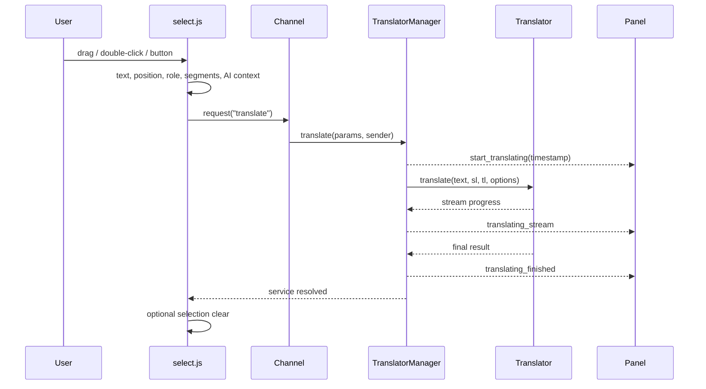
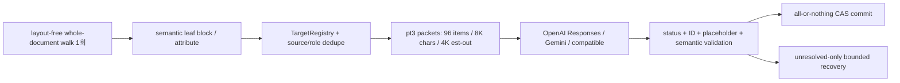
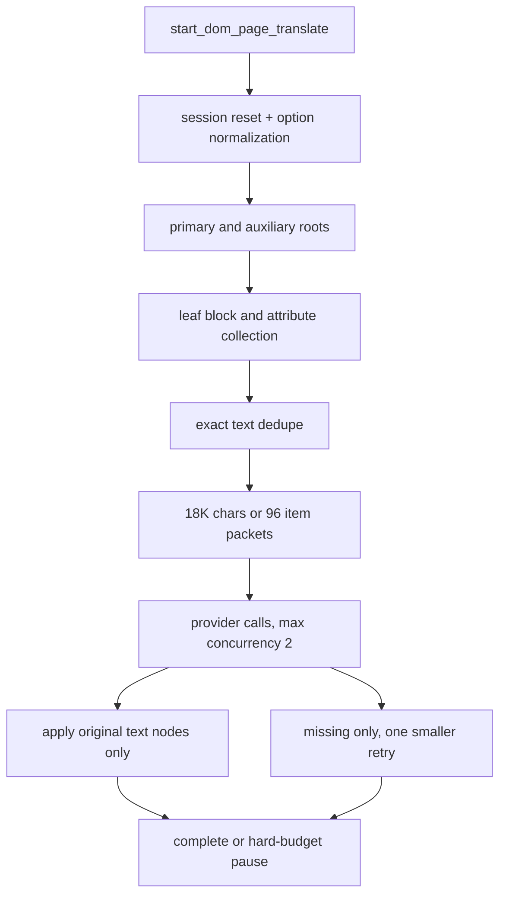

# EdgeTranslate-v3 개발 가이드

이 문서는 EdgeTranslate-v3의 현재 구현을 기준으로 다음 개발자가 구조를 다시 역추적하지 않고도 개발을 이어갈 수 있게 만든 개발 기준 문서다.

작성 기준은 2026-07-13의 현재 작업 트리다. 코드가 바뀌면 이 문서의 설정 기본값, Channel 계약, 브라우저별 manifest, 검증 현황도 함께 갱신한다.

빠른 이동:

-   [10분 온보딩](#3-10분-온보딩) · [저장소 지도](#4-저장소-지도) · [빌드 구조](#5-빌드-구조)
-   [브라우저 차이](#6-브라우저별-런타임-차이) · [런타임 컨텍스트](#7-런타임-컨텍스트) · [Channel](#8-channel-메시지-모델)
-   [선택 번역](#9-선택-번역-end-to-end) · [번역기](#10-번역기-subsystem) · [설정](#11-설정과-저장)
-   [페이지 번역](#12-ai-페이지-번역-파이프라인) · [Cache](#13-cache-계층) · [실시간 자막](#14-youtube-실시간-자막) · [PDF](#15-pdf-경로)
-   [Debug](#16-debug와-분석-도구) · [테스트](#17-테스트-전략) · [안전한 변경](#18-안전한-변경-절차) · [기술 부채](#19-알려진-위험과-기술-부채) · [릴리스](#20-릴리스)

## 1. 문서의 역할과 신뢰 순서

문서와 코드가 다를 때는 다음 순서로 판단한다.

1. 현재 소스 코드와 그 소스로 clean build한 생성 manifest
2. 단위 테스트와 CI
3. 이 개발 가이드
4. 기본 AI 페이지 번역 계약인 `docs/AI_PAGE_TRANSLATION_VNEXT.md`
5. rollback 계약인 `docs/AI_PAGE_TRANSLATION_STABLE.md`
6. 제품 개요인 루트 `README.md`
7. 역사 설계인 `docs/LLM_PAGE_TRANSLATION_SPEC.md`와 이전 AI page 문서
8. 원본 프로젝트에서 이어진 위키와 `RELEASE_CHECKLIST.md`

cloud AI의 `pipelineVersion=auto`/default는
`content/ai_page_translation`의 `pt3` vNext structured pipeline이다. 명시적 `stable`만
rollback runtime으로 간다. Chrome on-device engine은 기존 V1 bridge,
`GooglePageTranslate`는 별도 Google injection 경로다. 페이지 번역을 수정할 때는
`AI_PAGE_TRANSLATION_VNEXT.md`를 먼저 본다.

## 2. 프로젝트 한눈에 보기

EdgeTranslate-v3는 Manifest V3 기반 브라우저 번역 확장이다. 사용자 기능은 크게 여섯 영역으로 나뉜다.

-   선택 번역과 번역 결과 패널
-   Google, Bing, DeepL, Hybrid 번역
-   Chrome 내장 AI, Google AI Studio, OpenAI, OpenAI-compatible 번역
-   Google 또는 AI 기반 전체 페이지 번역
-   YouTube 실시간 자막 번역
-   번들 pdf.js 뷰어와 PDF 선택 번역

저장소는 두 workspace로 구성된다.

| Workspace                | 역할                                       | 주 언어/도구                                  |
| ------------------------ | ------------------------------------------ | --------------------------------------------- |
| `packages/EdgeTranslate` | 브라우저 확장 런타임, UI, PDF 뷰어, 테스트 | JavaScript/JSX, Preact, Stylus, Gulp, Webpack |
| `packages/translators`   | 번역 제공자와 공통 결과 타입               | TypeScript, Vite, Jest                        |

루트 Turbo는 workspace build 순서와 cache를 관리한다. 확장 Webpack은 번역기 소스가 아니라 `packages/translators/dist/translators.es.js`를 직접 참조한다. 따라서 번역기 소스를 수정한 뒤 확장 workspace만 직접 빌드하면 누락되거나 오래된 `dist`를 사용할 수 있다. 루트 `build:*` 명령은 번역기 build를 먼저 실행하므로 이 경로를 우선한다.

## 3. 10분 온보딩

### 3.1 환경

-   CI 기준 Node.js: 22
-   로컬 권장 범위: Node.js 22.13 이상 또는 24 이상 (`pdfjs-dist` engine 기준)
-   패키지 관리자: npm
-   저장소에는 `.nvmrc`, `packageManager`, `engines` 고정값이 없다.
-   Safari 개발에는 macOS와 Xcode가 필요하다.
-   Firefox 제출 검증은 `npx web-ext@8.9.0`을 내려받을 수 있어 네트워크가 필요할 수 있다.

### 3.2 설치, 테스트, 빌드

저장소 루트에서 실행한다.

```bash
npm ci
npm test
npm run build:chrome
```

브라우저별 production build:

```bash
npm run build:chrome
npm run build:firefox
npm run build:safari
```

패키징과 Firefox 제출 전 검사:

```bash
npm run pack:chrome -w edge_translate
npm run pack:firefox -w edge_translate
npm run lint:firefox
```

### 3.3 로컬 확장 로드

-   Chrome: `chrome://extensions` → Developer mode → Load unpacked → `packages/EdgeTranslate/build/chrome`
-   Firefox: `about:debugging#/runtime/this-firefox` → Load Temporary Add-on → `packages/EdgeTranslate/build/firefox/manifest.json`
-   Safari: `packages/EdgeTranslate/safari-xcode/EdgeTranslate/EdgeTranslate.xcodeproj`

로컬 PDF를 번역하려면 Chrome 확장 상세 화면에서 **Allow access to file URLs**를 별도로 켜야 한다.

Safari의 `build:safari`는 `build/safari`까지만 만든다. Xcode project에서 실행하기 전에는 resource를 동기화하거나 Safari dev watch를 사용한다.

```bash
npm run build:safari
npm run safari:sync -w edge_translate
```

### 3.4 개발 watch

번역기와 확장을 함께 수정할 때는 터미널을 나눈다.

```bash
npm run dev -w @edge_translate/translators
npm run dev:chrome -w edge_translate
```

다른 타깃:

```bash
npm run dev:firefox -w edge_translate
npm run dev:safari -w edge_translate
```

Safari watch는 단순 파일 복사만 하지 않는다. build 결과를 Xcode resource로 동기화하고 project를 패치한 뒤 unsigned Debug build까지 반복하므로 일반 watch보다 무겁다.

## 4. 저장소 지도

```text
.
├── package.json                       # workspace 공통 명령
├── turbo.json                         # build/test 의존 순서와 출력 cache
├── .github/workflows/ci.yml           # Node 22 CI
├── tools/                             # benchmark, smoke, 분석 도구
├── docs/
│   ├── DEVELOPMENT_GUIDE.md           # 현재 개발 기준 문서
│   ├── AI_PAGE_TRANSLATION_VNEXT.md        # 기본 cloud AI 페이지 번역 구현 계약
│   ├── AI_PAGE_TRANSLATION_STABLE.md       # 명시적 rollback 계약
│   ├── AI_PAGE_TRANSLATION_GOOGLE_STYLE.md # 과거 연속 번역 설계 기록
│   ├── AI_PAGE_TRANSLATION_V2_DESIGN.md    # 새 페이지 번역 목표 계약
│   ├── AI_PAGE_TRANSLATION_V2_BENCHMARK.md # V2 POC와 release gate
│   ├── LLM_PAGE_TRANSLATION_SPEC.md   # 현행/V1 페이지 번역 설계 이력
│   └── local-llm-translate-proxy.md   # 레거시 proxy 도구 주의사항
└── packages/
    ├── translators/
    │   ├── src/index.ts
    │   ├── src/types.ts
    │   ├── src/translators/
    │   │   ├── google.ts
    │   │   ├── bing.ts
    │   │   ├── deepl.ts
    │   │   ├── hybrid.ts
    │   │   └── local.ts
    │   └── test/
    └── EdgeTranslate/
        ├── gulpfile.js
        ├── config/webpack.*.config.js
        ├── src/
        │   ├── manifest*.json
        │   ├── background/
        │   ├── common/
        │   ├── content/
        │   ├── offscreen/
        │   ├── options/
        │   └── popup/
        ├── static/                    # locales, icon, Google assets, brand assets
        ├── web/                       # 번들 pdf.js viewer
        ├── test/unit/
        ├── test/e2e/
        └── safari-xcode/
```

핵심 파일 바로가기:

| 영역                     | 파일                                                                                                                             |
| ------------------------ | -------------------------------------------------------------------------------------------------------------------------------- |
| 공통 manifest            | [`src/manifest.json`](../packages/EdgeTranslate/src/manifest.json)                                                               |
| Background 조립          | [`background/background.js`](../packages/EdgeTranslate/src/background/background.js)                                             |
| 번역 orchestration       | [`background/library/translate.js`](../packages/EdgeTranslate/src/background/library/translate.js)                               |
| Channel                  | [`common/scripts/channel.js`](../packages/EdgeTranslate/src/common/scripts/channel.js)                                           |
| 설정 기본값              | [`common/scripts/settings.js`](../packages/EdgeTranslate/src/common/scripts/settings.js)                                         |
| pt3 wire contract        | [`common/scripts/ai_page_translation_protocol.js`](../packages/EdgeTranslate/src/common/scripts/ai_page_translation_protocol.js) |
| 선택 감지                | [`content/select/select.js`](../packages/EdgeTranslate/src/content/select/select.js)                                             |
| 선택 AI 문맥             | [`content/select/selectionContext.js`](../packages/EdgeTranslate/src/content/select/selectionContext.js)                         |
| 결과 패널                | [`content/display/Panel.jsx`](../packages/EdgeTranslate/src/content/display/Panel.jsx)                                           |
| 페이지/자막 controller   | [`content/banner_controller.js`](../packages/EdgeTranslate/src/content/banner_controller.js)                                     |
| vNext production runtime | [`content/ai_page_translation/`](../packages/EdgeTranslate/src/content/ai_page_translation/)                                     |
| stable rollback runtime  | [`content/ai_page_translation_stable/`](../packages/EdgeTranslate/src/content/ai_page_translation_stable/)                       |
| provider page adapters   | [`page_translation_v2/`](../packages/translators/src/page_translation_v2/)                                                       |
| DOM/IR 변환              | [`content/dom_page_translate_context.js`](../packages/EdgeTranslate/src/content/dom_page_translate_context.js)                   |
| PDF 감지                 | [`background/library/pdfDetection.js`](../packages/EdgeTranslate/src/background/library/pdfDetection.js)                         |
| AI provider              | [`translators/local.ts`](../packages/translators/src/translators/local.ts)                                                       |
| 페이지 lifecycle 테스트  | [`bannerController.test.js`](../packages/EdgeTranslate/test/unit/content/bannerController.test.js)                               |
| DOM/IR 테스트            | [`domPageTranslateContext.test.js`](../packages/EdgeTranslate/test/unit/content/domPageTranslateContext.test.js)                 |

## 5. 빌드 구조

### 5.1 도구별 책임

| 도구       | 책임                                                                      |
| ---------- | ------------------------------------------------------------------------- |
| Turbo      | workspace 의존 순서, `dist/**`와 `build/**` cache                         |
| Vite       | translators를 ES/UMD/IIFE 세 형식으로 build                               |
| TypeScript | translators declaration 파일 생성                                         |
| Gulp       | 브라우저 타깃, manifest 생성, lint, Stylus, 정적/PDF 자산, ZIP/XPI, watch |
| Webpack    | 확장 JavaScript entry bundle                                              |
| Babel      | 확장 JavaScript/JSX 변환, Preact JSX pragma                               |

### 5.2 Webpack entry

`packages/EdgeTranslate/config/webpack.base.config.js`가 다음 9개 entry를 만든다.

| 출력                           | 소스                               | 컨텍스트                         |
| ------------------------------ | ---------------------------------- | -------------------------------- |
| `background/background.js`     | `src/background/background.js`     | service worker/background script |
| `content/banner_controller.js` | `src/content/banner_controller.js` | 페이지 번역·자막 controller      |
| `content/select/select.js`     | `src/content/select/select.js`     | 선택 감지 content script         |
| `content/display/display.js`   | `src/content/display/index.js`     | Preact 번역 패널                 |
| `content/notice/notice.js`     | `src/content/notice/notice.js`     | notice tab                       |
| `popup/popup.js`               | `src/popup/popup.js`               | action popup                     |
| `options/options.js`           | `src/options/options.js`           | 설정 화면                        |
| `offscreen/chrome_prompt.js`   | `src/offscreen/chrome_prompt.js`   | Chrome on-device AI 문서         |
| `content/deepl_injector.js`    | `src/content/deepl_injector.js`    | DeepL iframe bridge              |

### 5.3 Gulp build 순서

Production build는 기존 타깃 산출물을 지운 뒤 다음 작업을 병렬로 실행한다.

1. ESLint
2. Webpack bundle
3. 공통 manifest와 브라우저 patch 병합
4. HTML 복사
5. Stylus → CSS
6. locales, icon, brand, Google 자산, pdf.js viewer와 core 복사

산출물:

| 타깃    | unpacked                               | package                            |
| ------- | -------------------------------------- | ---------------------------------- |
| Chrome  | `packages/EdgeTranslate/build/chrome`  | `build/edge_translate_chrome.zip`  |
| Firefox | `packages/EdgeTranslate/build/firefox` | `build/edge_translate_firefox.xpi` |
| Safari  | `packages/EdgeTranslate/build/safari`  | Xcode archive/export 경로 사용     |

### 5.4 manifest 병합의 중요한 함정

manifest는 일반적인 override merge가 아니다.

```js
obj = _.defaultsDeep(obj, patch);
```

즉 `src/manifest.json`의 값이 우선이고 브라우저 patch는 공통 manifest에 없는 값만 채운다. patch의 빈 배열이나 축약된 object로 공통 값을 지울 수 없다.

영향:

-   Chrome patch의 빈 `permissions`와 `background`는 공통 값을 제거하지 않는다.
-   Chrome patch의 다른 `homepage_url`도 공통 값을 덮어쓰지 않는다.
-   Safari patch의 축약 `commands`는 공통 페이지 번역 command를 삭제하지 않는다.
-   Firefox/Safari에서 꼭 제거하거나 변환할 항목은 Gulp 후처리가 직접 다룬다.

브라우저별 manifest를 수정할 때는 source JSON만 보지 말고 반드시 생성된 `build/<browser>/manifest.json`을 확인한다.

## 6. 브라우저별 런타임 차이

| 항목                               | Chrome                    | Firefox                            | Safari                      |
| ---------------------------------- | ------------------------- | ---------------------------------- | --------------------------- |
| background                         | MV3 module service worker | `background.scripts`로 변환        | `background.scripts`로 변환 |
| 페이지 번역 feature flag           | 켜짐                      | 꺼짐                               | 꺼짐                        |
| Google 페이지 번역 정적 자산       | 포함                      | 제외                               | 제외                        |
| `offscreen` permission/capability  | 포함                      | 제거                               | 제거                        |
| `banner_controller` content script | 포함                      | 포함                               | 제외                        |
| 선택 스크립트                      | all frames                | all frames + Firefox 선택 분기     | all frames                  |
| tab messaging                      | Chrome callback wrapper   | `browser.tabs.sendMessage` Promise | Chrome 호환 경로            |
| 옵션 메뉴 보완                     | 없음                      | action context menu 제공           | 없음                        |
| package/release                    | ZIP                       | XPI + web-ext lint                 | Xcode archive/export/upload |

Firefox 후처리는 페이지 번역 command를 제거하고 permissions/host permissions를 다시 쓴다. Safari는 `offscreen`, MV3 CSP object, module background 등 지원 차이를 후처리한다. Firefox/Safari에서도 offscreen JS bundle과 HTML 파일 자체는 build될 수 있지만 permission과 실행 capability가 없다. Safari command 축약은 `defaultsDeep` 때문에 완전한 삭제가 되지 않으므로 최종 manifest 검사가 필요하다.

## 7. 런타임 컨텍스트

### 7.1 Content script 주입 범위

Chrome/Firefox 기준:

| 스크립트               | 주입 시점      | frame      | 역할                  |
| ---------------------- | -------------- | ---------- | --------------------- |
| `display.js`           | document idle  | top frame  | 결과 패널 mount       |
| `select.js` + CSS      | document start | all frames | 선택 감지와 선택 버튼 |
| `banner_controller.js` | document idle  | top frame  | 페이지 번역과 자막    |
| `deepl_injector.js`    | DeepL 페이지   | all frames | iframe 번역 bridge    |

Safari는 `banner_controller.js`를 manifest에서 제외한다.

### 7.2 Background

`src/background/background.js`는 다음을 top-level에서 구성한다.

-   background 오류 처리와 service worker mock
-   PDF 감지 listener와 viewer enable flag
-   context menu 생성과 상태 동기화
-   `Channel`과 `TranslatorManager`
-   install/update migration
-   command, context menu, storage listener
-   페이지 번역과 persistent cache service

MV3 service worker에서는 listener를 비동기 초기화 뒤에 등록하면 이벤트를 놓칠 수 있다. PDF listener가 top-level에서 한 번만 등록되고 매 이벤트마다 enable flag를 확인하는 이유다. 새 listener도 가능하면 module 평가 중 동기적으로 등록한다.

### 7.3 Selection content

`src/content/select/select.js`는 선택 감지, blacklist, 일반/정밀 번역 버튼, 위치 계산, PDF 텍스트 정규화, semantic role, multi-block segment, AI 주변 문맥, `get_selection` service를 담당한다.

### 7.4 Display content

`src/content/display/index.js`가 Preact `Panel`을 mount한다. `Panel.jsx`는 번역 상태, 언어·translator 선택, pin/resize/move, TTS를 맡는다. `Result.jsx`는 세부 뜻·정의·예문·복사·편집·발음을 다룬다.

### 7.5 Banner content

`src/content/banner_controller.js`는 단일 파일이지만 실제로는 Google 페이지 번역 bridge, AI DOM 페이지 session, root/section/leaf queue, streaming apply, cache, 원문 tooltip, YouTube 자막, on-device bridge를 함께 가진다. 현재 가장 큰 변경 위험 지점이다.

### 7.6 Popup, options, notice, offscreen

-   `popup`: 입력 번역, 언어 설정, 상호 번역 설정
-   `options`: 모든 `setting-path` 초기화, migration, `chrome.storage.sync` 저장
-   `notice`: 일반 탭에 content script 메시지를 보낼 수 없을 때 결과 표시를 위해 여는 extension tab. 직접 로드한 Panel의 tab messaging 수신은 E2E 검증이 필요하다.
-   `offscreen/chrome_prompt`: Chrome on-device AI warmup/translate와 stream event

## 8. Channel 메시지 모델

`src/common/scripts/channel.js`는 Chrome runtime message 위에 service와 event를 구현한다.

```text
service request: { type: "service", service, params }
event:           { type: "event", event, detail }
```

현재 메시지는 주로 JSON 문자열로 직렬화한다. receiver는 문자열과 이미 parse된 object를 모두 허용하고 malformed message는 무시한다. service 오류는 `__edgeTranslateError` envelope로 호출자 Promise를 reject한다.

### 8.1 핵심 service

| Service                     | 주요 호출자 → 제공자                   | 용도                                            |
| --------------------------- | -------------------------------------- | ----------------------------------------------- |
| `translate`                 | select/popup/panel → TranslatorManager | 사용자에게 보이는 번역                          |
| `translate_text_quiet`      | banner → TranslatorManager             | 페이지·자막 번역, UI event 최소화               |
| `get_selection`             | background → select                    | context menu 선택 내용 회수                     |
| `check_availability`        | background → Panel                     | 현재 tab에 패널이 있는지 확인                   |
| `get_available_translators` | Panel/options → manager                | 언어쌍별 제공자 조회                            |
| `update_default_translator` | Panel → manager                        | 기본 제공자 변경. options는 storage를 직접 갱신 |
| `pronounce`                 | Panel/Result/select → manager          | TTS 시작                                        |
| `tts_finished`, `tts_error` | Panel → manager                        | 탭 TTS 완료/실패 전달                           |
| `chrome_builtin_translate`  | background → banner bridge             | 탭의 on-device AI 실행                          |
| `inject_on_device_bridge`   | banner → background                    | MAIN world bridge 주입                          |
| `warmup_gemini_nano`        | 명시적 caller 미확인 → manager         | 예약된 on-device session 준비 service           |
| `persistent_cache_prefetch` | banner → background                    | URL 단위 IndexedDB prefetch                     |
| `persistent_segment_get`    | banner → background                    | 문자열 단위 영속 cache 조회                     |
| `get_lang`                  | Google init → background               | UI 언어 조회                                    |

### 8.2 핵심 event

| Event                                              | 방향                         | 용도                                     |
| -------------------------------------------------- | ---------------------------- | ---------------------------------------- |
| `start_translating`                                | background → Panel           | loading 시작, timestamp 설정             |
| `translating_stream`                               | background → Panel           | 선택 번역 stream preview                 |
| `translating_finished`                             | background → Panel           | 최종 결과                                |
| `translating_error`                                | background → Panel           | 직렬화된 오류                            |
| `translation_stream_progress`                      | background → banner          | 페이지 stream 누적 텍스트                |
| `start_dom_page_translate`                         | background → banner          | AI DOM 페이지 번역 시작                  |
| `start_page_translate`                             | background → Google bridge   | Google 페이지 번역 시작                  |
| `page_translate_control`                           | background → banner          | 현재 consumer는 no-op hook               |
| `command`                                          | background → content scripts | keyboard command fan-out                 |
| `execute_tts`, `stop_tts`                          | background → Panel           | Web Speech 실행/정지                     |
| `pronouncing_finished`, `pronouncing_error`        | 양방향 중계                  | TTS 상태                                 |
| `language_setting_update`                          | popup/Panel → manager        | 언어 변경. options는 storage를 직접 갱신 |
| `update_translator_options`                        | manager → Panel              | 제공자 UI 갱신                           |
| `chrome_prompt_stream`                             | offscreen/bridge → manager   | on-device stream 전달                    |
| `persistent_cache_save`, `persistent_segment_save` | banner → background          | 영속 cache 저장                          |
| `set_realtime_caption_translate`                   | background → banner          | context menu 자막 상태 동기화            |

새 메시지를 추가할 때는 producer, consumer, 오류/timeout, tab이 없는 popup/options sender, Firefox Promise messaging을 함께 테스트한다.

## 9. 선택 번역 end-to-end



세부 규칙:

1. `SelectTranslate`, `TranslateAfterSelect`, `TranslateAfterDblClick`, blacklist로 실행 여부를 결정한다.
2. 선택 내용은 text와 화면 position뿐 아니라 role, multi-block segments를 만들 수 있다.
3. AI 번역일 때만 주변 block, title, domain 문맥을 전달한다. PDF, form/editable, 지나치게 긴 선택은 문맥 수집을 생략한다.
4. `translationProfile="precise"`는 별도 `PreciseLocalTranslate`를 선택한다.
5. mutual mode는 감지 결과나 dominant-script heuristic으로 방향을 바꾼다.
6. 각 요청은 timestamp를 갖고 Panel은 오래된 응답이 새 결과를 덮지 못하게 한다.
7. 동일 요청은 cache 또는 inflight Promise를 공유한다.
8. 선택 취소는 `translate` service가 완료된 뒤 실행된다.

현재 `translate_text_quiet`는 실패를 reject하지 않고 `translationFailed: true`와 원문 passthrough 결과를 반환한다. 페이지/자막 caller는 결과 객체가 resolve됐다는 이유만으로 성공으로 취급하면 안 된다.

## 10. 번역기 subsystem

### 10.1 TranslatorManager

`src/background/library/translate.js`는 설정 load, translator registry, 기본 언어쌍, mutual translation, selection/page/caption routing, TTS, cache/inflight dedupe, Chrome on-device queue, storage 변경 반영을 소유한다.

### 10.2 제공자

| ID/구현                 | 역할과 주의사항                                                             |
| ----------------------- | --------------------------------------------------------------------------- |
| `GoogleTranslate`       | 일반 선택 번역 기본값. 비공식 웹 번역 API 경로                              |
| `BingTranslate`         | 번역과 짧은 단어의 상세 뜻·예문                                             |
| `DeepLTranslate`        | DeepL iframe bridge. 감지/TTS 일부는 보조 translator 사용                   |
| `HybridTranslate`       | 필드별 제공자 결과를 조합                                                   |
| `LocalTranslate`        | 이름과 달리 on-device, Google AI Studio, OpenAI, compatible API를 모두 포함 |
| `PreciseLocalTranslate` | precise profile용 별도 LocalTranslator config proxy                         |

### 10.3 Local/AI mode

`packages/translators/src/translators/local.ts`의 현재 mode:

| Mode               | 설정 요구                           | 요청 경로                                            |
| ------------------ | ----------------------------------- | ---------------------------------------------------- |
| `chromeBuiltin`    | Chrome의 on-device API와 model 상태 | offscreen 우선. tab bridge 선택 조건은 E2E 검증 필요 |
| `googleAiStudio`   | API key, model                      | Google Generative Language API                       |
| `openai`           | OpenAI API key, model               | OpenAI chat completions                              |
| `openaiCompatible` | base URL, model, 선택적 API key     | `<base>/v1/chat/completions` 정규화                  |

중요한 명명 주의: 현재 background proxy의 `chromeBuiltin` 경로는 주로 Chrome Gemini Nano Prompt/LanguageModel bridge를 뜻한다. 같은 저장소에 Chrome Translator API helper도 존재하므로 이름만 보고 경로를 합치거나 바꾸지 않는다.

LocalTranslator는 selection, page, caption, dictionary profile마다 prompt와 output 처리 방식이 다르다. 제공자 코드를 수정할 때 stream/non-stream, dictionary JSON, truncation retry, reasoning parameter fallback을 함께 확인한다.

## 11. 설정과 저장

`src/common/scripts/settings.js`의 `DEFAULT_SETTINGS`가 유일한 기본값 기준이다.

| 설정                                       | 기본값/의미                                                       |
| ------------------------------------------ | ----------------------------------------------------------------- |
| `blacklist`                                | Chrome Web Store와 extension page 기본 제외                       |
| `LayoutSettings`                           | page resize off, RTL off, 긴 결과 fold on, 버튼 TopRight          |
| `languageSetting`                          | source auto, target 브라우저 UI 언어                              |
| `OtherSettings.SelectTranslate`            | `true`                                                            |
| `OtherSettings.TranslateAfterDblClick`     | `true`                                                            |
| `OtherSettings.TranslateAfterSelect`       | `false`                                                           |
| `OtherSettings.MutualTranslate`            | `false`                                                           |
| `OtherSettings.RealtimeCaptionTranslate`   | `false`                                                           |
| `OtherSettings.CancelTextSelection`        | `true`                                                            |
| `OtherSettings.EnableBuiltinPdfViewer`     | `true`                                                            |
| `DefaultTranslator`                        | `GoogleTranslate`                                                 |
| `DefaultPageTranslator`                    | `GooglePageTranslate`                                             |
| `AiPageTranslateConfig.lazyTranslate`      | `false`, legacy 호환 key; vNext는 읽기 위치 admission을 쓰지 않음 |
| `AiPageTranslateConfig.prefetchScreens`    | `0`, legacy 호환 key                                              |
| `AiPageTranslateConfig.tokenBudget`        | `-1`, vNext는 수동 budget pause를 사용하지 않음                   |
| `AiPageTranslateConfig.skipBoilerplate`    | `false`                                                           |
| `AiPageTranslateConfig.smartContentFilter` | `false`, 범용 eligible document를 모두 계획                       |
| `LocalTranslatorConfig.enabled`            | `false`                                                           |
| `LocalTranslatorConfig.mode`               | `chromeBuiltin`                                                   |
| `LocalTranslatorConfig.timeoutMs`          | `120000`                                                          |
| `PreciseTranslatorConfig.enabled`          | `false`, 선택 UI 노출 제어. context menu precise 경로는 별도      |
| `RealtimeCaptionConfig.translatorMode`     | `google`                                                          |
| `RealtimeCaptionConfig.draggableOverlay`   | `true`, 현재 runtime은 항상 draggable로 강제해 설정 효과 없음     |
| `AiPageTranslateConfig.pipelineVersion`    | `auto`/`vnext`=vNext, `stable`=명시적 rollback                    |
| `AiPageTranslateConfig.hardTokenBudget`    | `-1`, legacy 호환 key; vNext는 packet/recovery 상한을 사용        |
| `HybridTranslatorConfig`                   | main Google, detail Bing 중심                                     |
| `TranslateResultFilter`                    | main/detailed/definition 중심 표시                                |
| `ContentDisplayOrder`                      | main → original → detail → definition → examples                  |
| `HidePageTranslatorBanner`                 | `false`                                                           |

`getOrSetDefaultSettings`는 object를 재귀적으로 보완하고 `false`, `0`, 빈 문자열 같은 유효한 falsy 값은 보존한다. 기존 사용자 config migration은 `options/options.js`와 install/update handler에도 있으므로 기본값만 바꾸면 충분하지 않을 수 있다.

Local AI를 활성화하는 흐름은 Hybrid의 본문·원문 provider와 `DefaultTranslator`를 `LocalTranslate`로 영속 변경할 수 있다. 이후 Local AI를 비활성화해도 이전 Google/Hybrid 선택이 자동 복원되지는 않으므로 설정 UI나 migration을 수정할 때 이 부작용을 함께 검증한다.

### 11.1 API key 저장 주의

Google AI Studio, OpenAI, OpenAI-compatible key input은 화면에서 password type이지만 `LocalTranslatorConfig`의 일부로 `chrome.storage.sync`에 저장된다. 별도 암호화 계층은 없다.

-   key를 console, debug event, fixture, screenshot에 기록하지 않는다.
-   storage 구조를 바꿀 때 기존 사용자 key migration과 삭제 경로를 검토한다.
-   향후 `storage.local` 또는 별도 secret 저장으로 이동한다면 브라우저별 동기화 동작과 rollback을 설계한다.

## 12. AI 페이지 번역 파이프라인

기본값은 `pt3` **vNext structured runtime**이며
[vNext 운영 계약](./AI_PAGE_TRANSLATION_VNEXT.md)이 단일 구현 기준이다. 명시적
`pipelineVersion=stable`은 [rollback 계약](./AI_PAGE_TRANSLATION_STABLE.md)이다.

vNext는 generic DOM/ARIA 규칙으로 whole document를 layout read 없이 한 번 수집하고,
semantic leaf block과 inline placeholder IR로 묶는다. cache race는 최대 150ms이며 모든 miss와
CAS 재수집을 같은 `drain` lane에 넣는다. viewport/focus/scroll/reveal 우선순위, 두 번째
full-document scan, `countTokens` preflight, 수동 token-budget pause가 없다.

### 12.1 진입

`background/library/pageTranslate.js`가 `DefaultPageTranslator`를 읽는다.

-   `GooglePageTranslate`: 별도 Google script 주입
-   `AIPageTranslate`와 과거 호환 ID: engine과 `pipelineVersion`을 가진 DOM/AI pipeline
-   알 수 없는 값: Google fallback

AI 경로는 active tab에 engine, model, translator ID, source/target, AI page config와 함께
`start_dom_page_translate`를 보낸다. cloud `auto`/`vnext`는
`content/ai_page_translation`, `stable`은 rollback runtime, `chromeBuiltin`은 기존 V1
bridge로 분기한다. `DefaultPageTranslator`의 Google/AI 선택과 cloud 내부 pipeline 선택은
서로 다른 결정이다.

### 12.2 vNext 구현 계약 요약



-   inline wrapper는 `<gN>…</gN>`, opaque/synthetic Text-node boundary는 `<vN/>`로 표현한다.
-   comment나 `splitText()`로 나뉜 인접 node는 synthetic void boundary로 parser의 segment
    collapse를 막는다.
-   현재 prompt identity는 `pt3-2`다. placeholder는 고정 DOM 경계라 source 순서와 nesting을
    유지하고, URL/email/code/identifier/number는 정확히 보존한다. packet별 response schema도
    `x.minItems/maxItems`를 요청 수로 고정하고 `i.enum`을 packet-local alias로 제한한다.
-   표현 불가능한 interactive placeholder 어순은 `reinforced-order` 한 번 뒤 per-Text-node
    atomic으로 내려간다. recovery도 최초 요청과 같은 context-aware packet builder를 사용하므로
    긴 원문을 한 item으로 합쳐 context 한도를 넘지 않고 다시 chunk한다.
-   packet의 requested output은 estimated output에 1.25 headroom을 붙인다. official modern
    OpenAI/Gemini family cold floor는 8,192, 미분류 official model은 4,096,
    OpenAI-compatible은 1,024다. warm fallback discovery가 modern 8,192 floor를 낮추지
    않으며 provider metadata는 fallback보다 우선한다.
-   provider `maxInputTokens`/`maxCombinedTokens`가 있으면 90% 안전선 안에서 fixed prompt,
    item overhead, frozen page ctx와 1.25배 requested output을 함께 맞춘다. 단일 item은 같은
    한계까지 bounded chunking하고, fixed overhead도 들어가지 않으면 무과금 pre-dispatch
    `planner-capability` error로 terminalize하며 watcher/scheduler도 정리한다.
-   packet builder는 deterministic LPT best-fit으로 bin을 구성한다. dispatch는 같은 queue
    tier/limiter key에서 cap 전에는 작은 estimated-output packet부터(SPT) 보내 clean feedback으로
    slot을 빨리 열고, cap 뒤에는 큰 packet부터(LPT) 보내 full-drain tail을 줄인다.
-   provider AIMD row와 cap은 `common/scripts/ai_page_translation_limits.js`가 단일 source of
    truth다. OpenAI/Gemini는 current-epoch clean success마다 한 slot씩 빠르게 올리되, 429/5xx가
    epoch를 바꾸면 이전 in-flight의 stale success가 0.5배 감소를 즉시 되돌리지 못한다.
-   포화되거나 cooldown 중인 limiter key의 packet은 queue에 그대로 두고, 실행 가능한 다른 key를
    골라 multi-key head-of-line blocking을 막는다.
-   MV3 background는 모든 tab의 provider/API-key hash를 공유 FIFO gate로 묶는다. content cap과
    같은 값을 사용하며, provider timeout은 gate admission 뒤에만 시작하고 queue abort를 지원한다.
    admission 직후 cancel signal을 다시 확인하고, cancel 뒤 늦게 끝난 adapter reply는 completed
    cache에 재삽입하지 않는다.
-   OpenAI/Gemini는 production adapter의 실제 request/response shape를 그대로 구현한 local
    stub smoke로 무과금 검증할 수 있다.
-   startup hydration root를 buffer하고, unsafe long inline placeholder block은 per-Text
    atomic으로 degrade하며, active provider cancel은 terminal이다.
-   반복 inline wrapper는 placeholder stack depth 0 경계를 우선 사용한다. production session
    5,282-inline 회귀는 현재 22 packets / 23 balanced chunks이며 `<=30`, atomic fallback 없음,
    DOM identity 보존을 계약으로 고정한다.
-   same-packet backoff 실패는 idempotency completed cache에 남기지 않아 실제 재호출한다.
    success/delivery-unknown/recovery-class만 replay-safe cache 대상이다.
-   no-output circuit은 개별 HTTP 실패 횟수가 아니라 bounded retry가 모두 소진된 packet
    lineage만 센다. 첫 동시 429/5xx burst가 recovery 전에 전체 페이지를 중단하지 않는다.
-   recovery, global attempt ceiling, CAS, usage ledger와 2.5배 runaway latch는 모두 유한하다.
    normalized UsageReceipt `{value,source}`가 EMA를 보정하고, content-channel owner response
    loss도 estimated request 1회로 센다.
-   배너 token은 K/M 반올림 없는 exact integer이며 추정이 섞이면 `~`를 붙인다.
-   진단 snapshot은 DOM 발생 수인 `failedStrings`, 고유 dedupe 작업 수인
    `failedRepresentatives`, bounded terminal 분포인 `failedByReason`을 함께 제공한다.
-   전체 계약, exact-adapter 京阪本線 결과와 live gate 상태는
    [`AI_PAGE_TRANSLATION_VNEXT.md`](./AI_PAGE_TRANSLATION_VNEXT.md)를 본다.

### 12.3 레거시 V1 구현 기록

아래 marker/stream/viewport 설명은 `chromeBuiltin`이 계속 쓰는 기존 V1과 설계 이력이다.
cloud vNext 또는 stable rollback의 계약으로 사용하지 않는다.



핵심 원칙:

-   LLM은 언어를 번역하고 확장이 DOM 구조, 안전성, cache, scheduling, completion을 소유한다.
-   실제 `href`, `src`, `class`, `style`, `data-*`, event handler를 모델에 맡기지 않는다.
-   일반 문단은 compact `[[n]]`, 문맥 민감 UI text는 `[[n:title]]`, `[[n:date]]`, `[[n:label]]` 같은 sparse role marker로 결과를 leaf에 대응시킨다.
-   streaming 중 완성된 marker unit부터 rAF로 묶어 적용한다.
-   source echo, prompt echo, 목표 언어 부재, 구조 손상을 검사한다.
-   누락 marker는 성공한 leaf를 다시 보내지 않고 누락 부분만 제한적으로 재시도한다.
-   request count가 끝났다는 이유로 complete 처리하지 않고 실제 DOM coverage를 다시 본다.
-   MutationObserver와 후속 scan으로 SPA/hydration/late content를 수집한다.
-   session ID가 바뀌면 늦게 도착한 이전 응답, stream, persistence를 적용하지 않는다.

#### Page segment protocol v6

현재 page protocol/cache schema ID는 `seg-v6-semantic`이다. page prompt나 marker 의미를 바꿀 때 `LOCAL_TRANSLATOR_PROMPT_VERSION`, `AI_PAGE_SEGMENT_PROTOCOL_VERSION`, `AI_PAGE_PER_REQUEST_OVERHEAD_TOK`를 함께 검토한다.

-   system prompt는 marker 순서, 인접 segment 문맥, inline tag/code/URL/숫자/고유명 보존, source prose 완전 번역, `=` keep-source 규칙만 유지한다.
-   user header는 `English>Korean` 같은 언어쌍 한 줄만 붙인다. `Keep markers.`는 system prompt와 중복되어 제거했다.
-   paragraph/text role은 marker suffix를 생략한다. title/date/label/list/navigation/table-header/caption에만 읽을 수 있는 suffix를 붙인다.
-   표준 `tr`/ARIA row의 cell leaf와 같은 부모 아래 연속된 `li`/ARIA listitem은 각각 고정 길이 JSON 문자열 배열 한 개로 묶고 `:row`/`:list` role을 붙인다. URL, hostname, Wikipedia class 같은 사이트별 조건은 사용하지 않는다.
-   LLM은 HTML을 재생성하지 않는다. 응답 배열의 길이와 각 원소를 검증한 뒤 기존 DOM text target에 대응시키므로 link, attribute, listener와 layout은 브라우저가 소유한다. 배열 형식이 틀리면 실패한 semantic unit만 일반 leaf로 풀어 제한 재시도한다.
-   batch dedupe와 문자열 cache도 `role + text`를 사용한다. paragraph/text는 같은 기본 role로 접어 일반 문장의 재사용률을 유지한다.
-   page response parser는 문서 안의 `{"translation":"..."}` 예제를 dictionary JSON으로 추출하지 않는다. fence/reasoning/prompt echo만 걷고 marker parsing은 content controller에 맡긴다.
-   page 요청은 LocalTranslator에서 transport 재시도를 하지 않는다. 429/5xx/stream 단절은 `httpStatus`, `retryable`, `providerRetryExhausted`, `errorCode`, raw partial output과 함께 content로 올리고, BannerController가 완성 marker를 먼저 salvage/cache한 뒤 미완료 leaf만 작은 payload로 한 번 지연 재시도한다. 두 번째 transport 실패는 terminal이다. 이 계층 배치는 같은 큰 payload를 provider와 controller가 중복 재생성하던 비용을 없앤다. terminal leaf는 같은 source fingerprint인 동안 그 세션의 coverage sweep에서도 제외된다. 사용자가 번역을 다시 시작하거나 SPA가 실제 leaf text를 교체하면 이 차단과 logical failure count가 해제된다. context/input-size 오류는 payload가 매번 엄격히 작아지도록 entry → leaf 단위까지 재귀 반분하고, atomic leaf도 맞지 않으면 종료한다. 정상 응답의 missing leaf만 누락 부분으로 제한 재시도한다.
-   truncation/끊긴 stream은 provider가 multi-marker payload 전체를 다시 생성하지 않고 마지막 미완성 marker를 버린 완성 prefix를 반환한다. 완성 prefix가 하나도 없는 multi-marker 응답은 controller의 구조 분할로 넘긴다. 더 나눌 수 없는 single-marker만 provider가 실제로 더 큰 output cap을 지원할 때 새 AbortController/deadline으로 한 번 복구한다. read 자체가 실패해도 raw prefix와 usage를 failure result에 실어 보내므로 content가 완성 marker를 먼저 salvage할 수 있다.
-   `SAFETY`, `RECITATION`, `content_filter`처럼 정상 stop/length가 아닌 terminal finish reason은 `PAGE_OUTPUT_BLOCKED`다. 이 응답은 prefix를 cache/salvage/retry하지 않으며, finish reason이 도착하기 전에 stream으로 그려진 leaf도 직렬화된 원문으로 되돌린다.
-   provider usage가 있으면 실제 필드를 우선한다. usage-only chunk가 없거나 호환 서버가 usage를 보내지 않으면 각 request attempt의 실제 system/user prompt와 raw output(미완성 tail 포함)으로 input/output/total을 보수적으로 추정하고 `estimated=true`로 표시한다. 실패와 controller tail-recovery attempt도 합산하며, UI는 추정치가 섞이면 `~`를 붙인다. LocalTranslator와 background cache는 과거 `tokenUsage`를 저장하지 않아 cache hit가 비용을 재계상하지 않는다. 동일 in-flight request의 joiner도 성공/실패 결과만 복제하고 usage는 provider call owner 한 곳에만 남긴다.

### 12.4 레거시 V1 scheduling과 보호 장치

기본 `lazyTranslate=true`, `prefetchScreens=8`, `tokenBudget=8000`이다. 첫 화면과 가까운 section을 우선하고 먼 section은 backlog에 둔다. 초기 keep과 backlog promotion은 같은 세션 예산을 공유하며, IntersectionObserver와 scroll fallback이 읽기 약 2.5화면 전에 필요한 backlog만 승격한다. `tokenBudget=-1`만 명시적 무제한이다. 추정 input이 12K 이상인 긴 문서는 `smartContentFilter=true`에 의해 references/reflist/navbox/category/TOC/edit apparatus를 자동 제외한다. 본문, 제목, 목록, infobox와 데이터 표는 계속 번역 대상이다.

첫 visible entry 하나만 전용 stream lane으로 보내 TTFT를 확보하고, 나머지 visible entry는 batch 앞부분에 둔다. Cloud LPT는 부하를 나눈 뒤 각 bin 내부를 다시 DOM 순서로 정렬하고, overflow wave도 가장 이른 entry가 있는 bin부터 enqueue한다. URL persistent prefetch는 첫 호출자가 소비하는 boolean latch가 아니라 세션 단위 공유 Promise를 사용하므로 같은 첫 wave의 모든 요청이 동일한 최대 150ms gate를 기다린 뒤 cache를 확인한다.

Cloud provider마다 concurrency와 batch 크기가 다르고 success/failure/latency에 따라 일부 값이 동적으로 조정된다. 화면 진행률의 `N sections`는 API 요청 수가 아니다. 건강한 cloud 상태에서는 작은 logical section을 input/output token과 marker leaf cap까지 묶되, 검증되지 않은 모델에 100개가 넘는 marker를 강요하지 않도록 provider별 item cap도 둔다(Gemini 96, OpenAI/default 48). 따라서 각 token cap 안에 드는 batch-eligible tiny section 122개는 planner에서 보통 Gemini 2 batch 요청, OpenAI 3 batch 요청으로 묶인다. 전체 wave는 빠른 첫 표시를 위한 lead stream 1요청을 별도로 두므로 controller 요청 총계는 보통 각각 3개와 4개이고, retry가 생기면 배너의 실제 request count에 따로 더해진다. `unitTarget`은 요청당 최소 효율 크기이므로 planner는 `floor(totalOutput / unitTarget)`만큼만 병렬 slot을 채우며, 2,001 output을 1,000-token 요청 두 개로 쪼개 고정 prompt를 두 번 내는 식의 과분할을 하지 않는다. 첫 실패 뒤에는 보수적인 item tier를 다시 적용한다. 단일 unique unit의 최종 응답이 marker 없이 번역문만 반환한 경우에는 normal reply sanitizer를 통과해야만 `[[1]]`로 복구한다. 2-4개 entry가 전부 marker-format 실패하면 같은 batch를 반복하지 않고 entry별 1회 복구로 격리하며, 더 큰 실패 집합은 request 폭주를 막기 위해 한 번만 반분한다.

보호 장치:

-   bounded partial retry와 per-element give-up
-   token/output runaway gate
-   adaptive marker cap
-   circuit breaker와 recovery timer
-   ordered apply queue
-   stale session suppression
-   queue/active-idle completion gate와 current-DOM logical-section terminal failure 누적. 하위 size-split이 남아 있으면 100%로 표시하지 않고, 최종 미번역 leaf가 있으면 `Translation incomplete`를 유지한다. 실패 leaf가 SPA에서 교체되거나 DOM에서 제거되면 owner별 남은 실패 leaf를 재계산해 오래된 incomplete 상태를 지운다.

### 12.5 레거시 V1 DOM 안전성

순수 변환과 sanitization은 `content/dom_page_translate_context.js`에 둔다. 이 파일은 번역 제외 element, safe inline representation, attribute stripping, marker serialize/parse, translated HTML sanitization, original structure 복원, text node/section apply를 맡는다.

페이지 번역의 자체 sanitizer와 구조 검사를 제거하거나 우회하는 변경은 보안과 페이지 파손 위험이 크다. `DOMPurify`는 현재 `Result.jsx`의 결과 예문 렌더링에 사용되며 페이지 번역 sanitizer가 아니다. 순수 변환은 이 파일과 `domPageTranslateContext.test.js`, queue/session/cache/coverage는 `banner_controller.js`와 `bannerController.test.js`에서 검증한다.

### 12.6 레거시 V1의 최적화 경계

다음은 현재 구현이 보장하지 않는다. 후속 개발에서 “이미 해결됨”으로 가정하지 않는다.

-   dedupe는 한 `buildAiPageBatchPayload` 안에서는 role-aware지만, 동시에 실행 중인 서로 다른 batch 사이의 in-flight string owner/fan-out은 없다.
-   streaming apply는 rAF로 합치지만 매 drain에서 누적 buffer를 다시 parse한다. 아주 큰 동시 stream에는 incremental cursor parser가 후속 후보다.
-   marker는 여전히 일반적인 `[[n]]` namespace다. 원문 literal과의 충돌을 없애려면 namespace와 escape 규칙을 함께 바꿔야 한다.
-   usage fallback은 provider tokenizer, prompt-cache hit, 숨은 reasoning token을 직접 알 수 없는 heuristic이다. `~` 누적치는 runaway 방어에는 사용하지만 청구서 수준의 정확한 비용으로 해석하지 않는다.
-   32-bit 단일 FNV 충돌은 길이와 독립 seed 두 개를 조합한 fingerprint로 줄였지만 cryptographic identity는 아니다.
-   content controller cache key에는 engine/model은 있지만 OpenAI-compatible base URL 자체는 전달되지 않는다. 같은 model 이름으로 endpoint를 바꿀 때 persistent cache를 엄격히 분리하려면 start contract에 endpoint/profile fingerprint를 추가해야 한다.
-   role은 짧은 UI text의 큰 오역 범주를 분리하지만 가까운 heading/domain 같은 context scope까지 key에 넣지는 않는다. 같은 role의 다의어가 실제로 재현되면 긴 문단 전체에 context를 붙이기보다 짧은 segment에만 제한된 scope hash를 추가한다.

## 13. Cache 계층

아래 표에는 선택 번역, V1, stable rollback의 cache도 함께 있다. cloud vNext의 기준은
`runtime/translation_cache.js`다. vNext는 `pt3`, source/target, role, normalized source
fingerprint와 7일 TTL을 사용하고 model은 key가 아니라 value metadata로 둔다. cloud quality
tier보다 낮은 결과, prompt major가 다른 결과, `=` sentinel, degraded atomic 결과는
persistent hit로 쓰지 않는다.

| 계층                                | 범위                    | 현재 한도/TTL                    |
| ----------------------------------- | ----------------------- | -------------------------------- |
| TranslatorManager detect cache      | background 전역         | 1,000 entries, 10분              |
| TranslatorManager translation cache | background 전역         | 1,000 entries, 60분              |
| LocalTranslator cache               | AI translator instance  | 200 entries, 10분                |
| Hybrid cache                        | Hybrid instance         | 250 entries, 15분                |
| Google cache                        | Google instance         | 200 entries, 2분                 |
| Bing cache                          | Bing instance           | 100 entries, 10분                |
| page section cache                  | 현재 content controller | 2,000 entries                    |
| page string cache                   | 현재 content controller | 6,000 entries                    |
| realtime caption cache              | 현재 content controller | 200 entries                      |
| IndexedDB persistent cache          | 브라우저 profile        | 7일, memory mirror 4,000 entries |

Persistent store는 `edge-translate-cache`, version 1, `translations` object store를 사용한다. URL 단위 prefetch와 전역 문자열 lookup을 모두 지원한다.

### 13.1 Cache key를 바꿔야 하는 경우

LocalTranslator와 manager cache는 prompt version을 key에 포함한다. 이 절의
`seg-v6-semantic`, engine/model 기반 page key는 기존 V1용이다. vNext의 `pt3` key와 혼용하지
않는다.

다음을 바꿀 때는 cache version 또는 명시적 invalidation을 함께 설계한다. `persistent_cache_clear` consumer는 있지만 현재 이를 호출하는 명시적 UI/producer가 없으므로, 사용자가 이미 cache를 지울 수 있다고 가정하면 안 된다.

-   page prompt 의미
-   marker/keep-source protocol
-   section/leaf serialization
-   source echo/target-script validation
-   provider별 page profile
-   HTML apply semantics

그렇지 않으면 새 코드가 최대 7일 동안 이전 결과를 재사용해 회귀가 재현되지 않거나 수정이 적용되지 않은 것처럼 보일 수 있다.

## 14. YouTube 실시간 자막

실시간 자막 경로는 현재 `youtube.com` 전용이다.

1. 설정 또는 context menu로 활성화
2. native caption visibility와 video 상태 확인
3. DOM caption과 player response의 caption track 수집
4. JSON/XML cue parse와 중복 정리
5. 근처 cue prefetch 또는 visible caption 즉시 번역
6. 늦은 응답과 seek 이전 응답 차단
7. draggable two-row overlay 갱신

기본 mode는 Google이다. AI mode는 LocalTranslator config가 활성화되고 지원되는 cloud AI mode일 때 사용한다. 자막은 latency가 중요해 일반 page prompt보다 짧은 timeout, 작은 microbatch, 별도 cache/stabilization 정책을 사용한다.

자막 수정 시 fragment 중복, 세 줄 누적, seek 뒤 과거 응답, native caption toggle, 빈/음향 cue, prefetch failure를 확인한다. 현재 `fastTranslatorId`가 비어 있어 기본 실행에는 Google fast fallback과 AI 결과의 이중 경합이 없지만, 이 경로를 다시 활성화할 때는 늦은 결과가 화면을 덮는지 별도로 검증한다.

## 15. PDF 경로

### 15.1 감지와 redirect

Background 시작 시 PDF listener를 한 번 등록한다.

-   `webRequest.onHeadersReceived`: main-frame MIME과 content-disposition 검사
-   `webNavigation.onCommitted`: URL hint/domain/cache 확인
-   불확실한 URL: HEAD 후 필요하면 Range GET probe
-   확인된 PDF: `web/viewer.html?file=<url>&source=<url>`로 이동

`OtherSettings.EnableBuiltinPdfViewer !== false`가 redirect를 gate한다. 원본으로 돌아가는 링크에는 bypass marker를 붙여 반복 redirect를 피한다.

### 15.2 번들 viewer

`packages/EdgeTranslate/web`은 pdf.js viewer와 EdgeTranslate theme/control을 포함한다. 외부나 file PDF는 필요한 경우 blob으로 preload한다. viewer는 선택 번역을 위해 `select.js`와 `display.js`를 직접 로드한다.

브라우저 native PDF document는 `document.contentType === "application/pdf"`로 감지한다. 이 페이지에 Panel을 mount하면 embed를 깨고 빈 화면이 될 수 있어 select/display/banner가 즉시 종료한다. 번들 viewer는 `text/html`이므로 이 guard에 걸리지 않는다.

### 15.3 현재 검증 필요 영역

정적 연결을 기준으로 다음은 완료된 기능으로 단정하면 안 된다.

-   PDF 선택 번역 결과 event가 번들 viewer의 Panel까지 실제 브라우저에서 도달하는지
-   PDF 전체 번역용 controller/event 코드가 실제 UI trigger와 연결되어 있는지
-   Chrome/Firefox/Safari의 file URL 권한 차이
-   native viewer bypass가 URL fragment/query를 보존하는지

현재 viewer HTML은 `banner_controller.js`를 직접 로드하지 않고, PDF 전체 번역 custom event의 명시적 dispatcher도 확인되지 않는다. PDF 전체 번역은 코드 존재만으로 지원된다고 문서화하지 않는다.

## 16. Debug와 분석 도구

### 16.1 페이지 번역 debug

```js
localStorage.setItem("edgeTranslate.domPageDebug", "1");
location.reload();
window.__edgeTranslateDomPageDebugEvents;
```

해제:

```js
localStorage.removeItem("edgeTranslate.domPageDebug");
```

### 16.2 자막 debug

```js
localStorage.setItem("edgeTranslate.captionDebug", "1");
location.reload();
window.__edgeTranslateCaptionDebugEvents;
```

각 debug buffer는 최대 500개 event를 유지하고 DOM mirror node도 만든다. 민감한 페이지나 번역 원문이 포함될 수 있으므로 공유 전 내용을 검토한다.

### 16.3 도구

```bash
npm run bench:ai-page -- --sections=80 --paragraphs=2 --iterations=25
npm run bench:ai-page:v2 -- --mode=offline --fixture=all
npm run bench:ai-page:stable
npm run gate:ai-page:vnext:offline
npm run bench:translation
npm run build:chrome
npm run smoke:ai-page:default:chrome -- --expect-pipeline=vnext
npm run smoke:ai-page:stable:chrome -- --expect-pipeline=stable
npm run smoke:ai-page:vnext:chrome -- --stub-provider=openai
npm run smoke:ai-page:vnext:chrome -- --stub-provider=gemini
npm run smoke:ai-page:vnext:wikipedia
npm run smoke:ai-page:vnext:wikipedia:gemini
npm run smoke:chrome-translation
node tools/ai-page-dispatch-sim.mjs
node tools/find-untranslated.mjs /path/to/page.html
node tools/token-breakdown.mjs /path/to/page.html
```

두 Wikipedia script의 30-request check는 京阪本線 fixture 전용 regression ceiling이다.
임의의 페이지에 대한 global 30-request 보장이 아니다. 더 큰 문서는 provider output/input/item
경계를 지키기 위해 더 많은 request가 필요할 수 있다.

주의:

-   `find-untranslated.mjs`와 `token-breakdown.mjs`에는 현재 저장소 절대 경로가 들어 있어 checkout 위치가 다르면 먼저 수정해야 한다.
-   기존 `smoke:chrome-translation`은 기본 macOS Chrome 경로를 사용하고 자체 browser process/profile을 띄운다. `CHROME_BIN`, `CHROME_USER_DATA_DIR`, `CHROME_REMOTE_DEBUGGING_PORT`, `EDGE_TRANSLATE_EXTENSION_DIR`로 조정할 수 있다.
-   `smoke:ai-page:default|stable|vnext:chrome`는 실제 build를 격리된 Chrome for
    Testing/Chromium profile에 로드한다. `--stub-provider=openai|gemini`는 production
    adapter의 OpenAI Responses/Gemini generateContent request·response shape와 같은 local
    endpoint를 쓰므로 key와 비용이 없다. 일반 Chrome 배포판이 command-line unpacked
    extension을 제한하면 `CHROME_PATH`에 extension-capable browser를 지정한다.
-   CDP smoke runner의 WebSocket client는 root의 직접 dev dependency인 `ws`를 사용한다.
-   `bench:ai-page`는 실제 leaf serializer와 role-aware IR을 사용하고 prompt 고정비, role marker 추가비, cloud planner proxy, boilerplate fixture를 출력한다. 그래도 synthetic/heuristic benchmark이며 실제 provider TTFT·decode rate·번역 품질을 측정하지 않는다.
-   `bench:ai-page:v2`는 P0의 array-fixed/array-exact/ID-object wire와 schema 오버헤드만 비교한다. 모든 token은 `client-estimated`이며 `--json`을 붙일 때 상세 결과를 출력한다.
-   실제 provider P1/P2는 `bench:ai-page:v2 -- --mode=provider ... --dry-run`으로 먼저 예약량을 확인한다. 실제 실행은 환경 변수 key, `--confirm-provider-cost`, `--hard-run-budget`가 모두 필요하며 packet당 generation을 한 번만 호출하고 `.artifacts/ai-page-v2`에 원장을 남긴다. key와 원문은 원장에 기록하지 않는다.
-   live Chrome provider mode는 fresh/rotated key를 `OPENAI_API_KEY` 또는 `GEMINI_API_KEY`
    환경 변수로만 주입하고 명시적 비용 승인 후 실행한다. 대화·명령 history·저장소·fixture에
    key를 넣지 않는다. 노출된 key는 재사용하지 않는다. 먼저 cost preflight와
    `--hard-run-budget`을 제공하는 benchmark harness로 지출 상한을 확인한다.
-   `bench:translation`의 live mode나 smoke는 외부 API/model 상태에 의존하며 단위 테스트의 대체가 아니다.

다음 2026-07-12 표는 **V1 역사 synthetic reference**이며 vNext release evidence가 아니다
(`80 sections × 2 paragraphs`, 25 iterations):

| Metric                               | Result                                       |
| ------------------------------------ | -------------------------------------------- |
| raw HTML → segment IR payload        | 173,492 → 56,213 chars, `-67.6%`             |
| estimated content input              | 48,193 → 15,671 tokens, `-67.5%`             |
| fixed page prompt/header estimate    | 164 → 131 tokens/request, `-20.1%`           |
| cloud planner proxy                  | 8 → 8 requests                               |
| estimated output per slowest request | 2,419 → 2,419 tokens                         |
| fixed prompt total at that split     | 1,312 → 1,048 tokens, `-20.1%`               |
| sparse role-hint input cost          | +133 estimated tokens across 240 leaf units  |
| encyclopedia boilerplate fixture     | 268 → 61 leaves, input `-66.6%` when skipped |
| generic semantic DOM fixture         | 1,298 → 276 markers, input `-18.8%`          |

이 표의 raw HTML 대비 IR 감소는 compact DOM-owned architecture 전체의 비교이지 이번 변경만의 순증분 효과가 아니다. planner/request 수는 synthetic planner 결과이며 실제 API latency나 품질 점수가 아니다. 특히 role hint는 품질을 위한 비용이고 output marker echo에도 유사한 추가비가 생긴다. encyclopedia 행은 긴 문서에서 자동 활성화되는 smart content filter의 기대 절감 폭이며, 일반 짧은 페이지의 절감률을 뜻하지 않는다. generic semantic DOM 행은 사이트별 class 없이 표준 table/ARIA/list 구조만 넣은 fixture(266 rows, 1,178 cells, 120 list items)의 leaf IR 대비 결과다.

## 17. 테스트 전략

### 17.1 기본 명령

```bash
# 전체 workspace pipeline
npm test

# 확장 단위 테스트만
npm test -w edge_translate -- --runInBand

# translator 단위 테스트만
npm test -w @edge_translate/translators -- --runInBand
```

`npm test -- --runInBand`처럼 루트 Turbo 명령 뒤에 Jest flag를 붙이면 Turbo가 알 수 없는 flag로 처리할 수 있다. Jest flag가 필요하면 workspace 명령을 직접 사용한다.

2026-07-13 현재 작업 트리에서는 Chrome build, EdgeTranslate 53 suites/972 tests,
translators 11 suites/178 tests가 통과했다. default pipeline smoke는 observed vNext,
8 requests(initial 6 + late content 1 + late attribute 1), failed/recovery 0이었다. explicit
stable smoke는 observed stable, 5 requests, failed 0이었다. test 개수 자체는 고정 gate가
아니므로 변경 뒤에는 현재 명령 output과 CI artifact를 다시 증거로 남긴다.

실제 京阪本線 DOM을 production collector/planner와 exact-adapter local stub로 실행한 최신
구조 smoke는 OpenAI/Gemini 각각 baseline generation 27 requests, 2,004/2,004 targets,
1,697 unique provider items, 116,501 source chars, failed/recovery 0, anchor 100개 보존,
runtime exception 0이었다. stub usage 98,189/98,244는 회계 경로용 합성값이며 실제
token/비용/품질이 아니다. 상세 해석과 남은 live Gates C-F는
[`AI_PAGE_TRANSLATION_VNEXT.md`](./AI_PAGE_TRANSLATION_VNEXT.md)를 따른다.
여기서 30 requests는 같은 fixture의 회귀 상한일 뿐 arbitrary page cap이 아니다.

같은 OpenAI-shaped local deterministic latency smoke를 scheduler 최적화 전후 한 번씩 실행한
결과는 full-page elapsed `4,421 ms → 3,914 ms`(-507 ms, -11.5%)였다. 두 실행 모두
27 requests / 1,697 provider items / 98,189 synthetic tokens였고 failed/recovery/runtime
exception은 모두 0이었다. 이 stub는 JSON byte length/4의 synthetic token과
`base + outputTokens × perTokenDelay` 모델을 쓰므로, paid-provider latency·품질·실제 token·비용
증거가 아니다. 단일 simulation 비교라 live latency Gate D도 여전히 미실행이다.
최종 빌드의 같은 조건 재실행은 4,118 ms였고 requests/items/tokens와 실패 수는 동일했다.
provider delay 외의 Chrome/DOM 실행 시간에는 변동이 있다는 점까지 포함해 해석한다.

build 성공은 compile/package 증거일 뿐 실제 provider 품질, 브라우저 E2E, Safari Xcode
archive/signing 증거가 아니다.

### 17.2 E2E

E2E는 build를 자동으로 하지 않는다.

```bash
npm run build:chrome
npm run e2e:chrome -w edge_translate

npm run build:firefox
npm run e2e:firefox -w edge_translate
```

현재 E2E는 Selenium WebDriver, Mockttp HTTPS proxy 고정 포트 8080, `select.spec.js`와 `panel.spec.js`, 환경별 image snapshot, GUI browser/maximize, 100초 timeout을 사용한다.

현재 `chromedriver@100` pin은 현대 Chrome과 major version이 맞지 않을 가능성이 높다. 실행 전에 browser/driver 버전을 맞춘다. 실패 시 제품 회귀, driver mismatch, snapshot viewport, proxy port 충돌을 분리한다.

CI는 E2E를 실행하지 않는다. 현재 범위는 `npm ci`, unit tests, Chrome build, Firefox package/web-ext lint, Safari web extension build다.

### 17.3 변경 유형별 최소 검증

| 변경                  | 최소 테스트                                    | 추가 검증                        |
| --------------------- | ---------------------------------------------- | -------------------------------- |
| 선택 감지/context     | selectionContext, translateManager, select E2E | 일반 페이지, iframe, PDF         |
| Panel/Result UI       | 관련 unit + panel E2E                          | floating/pinned, resize, RTL     |
| settings/options      | settings, pageTranslate, translateManager      | 기존 storage migration           |
| translator provider   | 해당 provider + local/hybrid                   | stream, 429, timeout, dictionary |
| vNext page DOM/IR     | aiPageTranslationCollector/BlockIr/Registry    | inline order, comment split, CAS |
| vNext session/runtime | Session/Scheduler/Recovery/UsageLedger         | 긴 SPA, cancel, revisit cache    |
| page router/rollback  | bannerController + stable focused tests        | default vNext, explicit stable   |
| realtime caption      | bannerController focused tests                 | YouTube playback, seek, toggle   |
| PDF                   | pdfDetection, PDF viewer tests                 | web/file/blob PDF, native bypass |
| manifest/build        | manifestPermissions + 타깃 build               | 생성 manifest 직접 검사          |
| release               | 전체 test/build/lint                           | clean profile 핵심 journey smoke |

## 18. 안전한 변경 절차

### 18.1 설정 추가/변경

1. `DEFAULT_SETTINGS` 수정
2. options HTML input과 localization key 추가
3. `options.js` 표시 조건과 legacy migration 추가
4. `storage.onChanged` consumer 확인
5. cache invalidation 필요 여부 확인
6. falsy 값과 partial object migration test 추가

### 18.2 제공자 또는 prompt 변경

1. provider 구현과 stream/non-stream test를 함께 수정
2. LocalTranslator prompt version 갱신
3. manager의 local AI cache version도 함께 갱신
4. page prompt의 고정 길이가 바뀌면 `AI_PAGE_PER_REQUEST_OVERHEAD_TOK` 동기화
5. page profile이 바뀌면 persistent page cache version/invalidation 추가
6. dictionary, selection, page, caption profile을 각각 검증
7. model별 unsupported parameter fallback 유지

### 18.3 페이지 번역 변경

다음 보호 장치를 제거하거나 우회하지 않는다.

-   layout-free whole-document 1-pass collector와 사이트 비종속 eligibility
-   semantic leaf block, placeholder armor/inventory, synthetic void Text-node boundary
-   `pt3-2` fixed-order placeholder/protected-value prompt와 packet별 exact-count/alias schema
-   session ID, revision, live-source와 block all-or-nothing CAS
-   provider terminal status, ID/schema, semantic validator
-   unresolved-only shrinking recovery와 global attempt ceiling
-   auth/quota/model circuit, per-key AIMD/cooldown, 2.5배 runaway latch
-   shared AIMD/cap 설정, congestion epoch stale-ACK 차단, cap 전 SPT/cap 후 LPT dispatch
-   실행 가능한 limiter-key 선택과 포화 key의 queue 위치 보존
-   provider/API-key hash별 background cross-tab concurrency gate와 admission 후 timeout 시작
-   gate admission/cancel race의 zero-attempt 보장과 late cancelled reply cache 차단
-   `billingEventId` usage dedupe와 missing-usage null-not-zero accounting
-   backoff failure와 replay-safe result를 구분하는 idempotency cache
-   startup hydration root buffer와 active-provider cancel terminalization
-   normalized receipt EMA, content-channel owner-loss 1-request estimate, exact integer banner
-   unsafe inline chunk의 per-Text atomic degrade
-   interactive order constrained retry와 recovery 공통 context-aware rechunk
-   raw attempt가 아닌 retry-exhausted lineage 기준 no-output circuit
-   failure kind가 바뀌어도 공유되는 transport retry budget
-   recovery fragment `max(4, 2×initial)` 증폭 제한과 nested-chunk 금지
-   SPA revision 교체 시 stale success/failure/chunk/atomic reply no-op 및 group 정리
-   failed→SPA revised→success의 incomplete counter reconciliation
-   무공백 CJK prose echo를 identifier로 오인하지 않는 validator 경계
-   `failedStrings`/`failedRepresentatives`/`failedByReason` 분리 진단
-   `auto`/`vnext` → vNext, explicit `stable` rollback, `chromeBuiltin` → V1 경계

vNext DOM/IR/runtime은 `content/ai_page_translation/`에 둔다. provider wire/HTTP는
`translators/src/page_translation_v2/`, idempotent background relay는
`ai_page_translation_transport.js`가 소유한다. 새 lifecycle을 다시
`banner_controller.js` 안에 복제하지 않는다.

stable 삭제나 migration compatibility 제거는 live Gates C-F와 production soak 뒤 별도
release decision이다. page-specific selector로 fixture 하나만 통과시키지 않는다.

### 18.4 manifest 변경

1. 공통인지 타깃 전용인지 결정
2. `defaultsDeep` 방향 확인
3. 필요한 경우 Gulp 후처리 추가
4. 세 타깃 build
5. 생성 manifest diff 검사
6. Firefox web-ext lint
7. Safari Xcode resource/signing 영향 확인

### 18.5 PDF 변경

PDF는 navigation/header detection, redirect/bypass URL, blob/file preload와 pdf.js bootstrap, viewer 안의 select/display 네 층을 함께 본다. native PDF guard를 제거하면 브라우저 embed가 사라질 수 있다.

## 19. 알려진 위험과 기술 부채

### 19.1 책임 집중

작성 기준 주요 파일 규모:

| 파일                                    |  줄 수 | 책임                                       |
| --------------------------------------- | -----: | ------------------------------------------ |
| `content/banner_controller.js`          | 11,466 | page, caption, cache, queue, banner, debug |
| `translators/local.ts`                  |  2,789 | 모든 AI provider와 prompt profile          |
| `content/display/Panel.jsx`             |  2,099 | 결과 panel UI와 interaction                |
| `background/library/translate.js`       |  2,021 | 전체 translation orchestration             |
| `content/dom_page_translate_context.js` |  1,873 | DOM/IR/sanitization/apply                  |
| `content/display/Result.jsx`            |  1,364 | 세부 결과 UI                               |

`banner_controller.js`는 Babel의 500KB 대형 파일 최적화 해제 경고도 발생한다. 단순 줄 수보다 session, stream, cache, DOM mutation이 한 객체에 결합된 것이 더 큰 위험이다.

### 19.2 Toolchain

-   root/extension은 Jest 27, translators는 Jest/ts-jest 28을 선언해 실제 실행에서 version warning이 난다.
-   Turbo 1.x와 오래된 lint/build dependency가 남아 있다.
-   E2E ChromeDriver가 오래되어 현재 Chrome과 맞지 않을 수 있다.
-   이전 `CONTRIBUTING.md`의 명령과 branch 전략은 현재 repo에 맞지 않았다.

Toolchain upgrade는 제품 변경과 분리된 PR로 하고, 생성 산출물과 브라우저 E2E까지 비교한다.

### 19.3 정적으로 확인된 연결 공백

다음은 구현이 있거나 event가 선언돼 있지만 현재 producer/consumer가 완전하게 연결됐다고 확인되지 않았다.

-   Google script 주입 실패 시 emit되는 `inject_page_translate`의 consumer
-   Google banner가 기다리는 `edge_translate_page_translate_event`의 page-world producer
-   PDF 전체 번역 custom event dispatcher와 viewer의 banner controller 로딩
-   notice tab과 번들 PDF viewer에서 직접 로드한 Panel의 tab messaging 수신
-   일반 웹 탭에서 on-device tab bridge가 실제 fallback으로 선택되는 조건
-   일부 legacy Channel event/service
-   Safari patch가 의도한 page command 축약

이 항목은 삭제 대상이라고 단정하지 않는다. 실제 브라우저에서 호출 경로를 기록한 뒤 연결하거나 제거한다.

## 20. 릴리스

### 20.1 버전 동기화

최소 세 곳을 함께 갱신한다.

-   `packages/EdgeTranslate/package.json`
-   `packages/EdgeTranslate/src/manifest.json`
-   `package-lock.json`

Safari는 Xcode `MARKETING_VERSION`과 build number 정책도 별도로 확인한다.

### 20.2 권장 릴리스 검증

```bash
npm ci
npm test
npm run gate:ai-page:vnext:offline
npm run build:chrome
npm run smoke:ai-page:default:chrome -- --expect-pipeline=vnext
npm run smoke:ai-page:stable:chrome -- --expect-pipeline=stable
npm run lint:firefox
npm run build:safari
npm run pack:chrome -w edge_translate
```

그 뒤 clean browser profile에서 선택 번역, double click, popup, provider/언어 변경,
긴 AI page의 whole-document completion, cancel/restart, explicit stable rollback, YouTube 자막,
web/local PDF, native bypass, 설정 지속을 직접 확인한다.

### 20.3 Safari

`safari:release`는 build, resource sync, Xcode archive, export, upload를 수행하고 Apple credential이 필요하다. Fastlane 경로도 별도로 존재하지만 현재 release lane은 `safari:sync`를 직접 호출하지 않으므로 실행 전에 수동 sync가 필요하다. web extension build 성공은 Xcode archive/signing/notarization 성공을 의미하지 않는다.

## 21. 문서 유지 체크리스트

다음 중 하나가 바뀌면 이 문서도 갱신한다.

-   manifest permission, content script, command
-   Webpack entry 또는 output path
-   Channel service/event
-   `DEFAULT_SETTINGS`와 migration
-   translator ID/mode/model contract
-   page marker/IR/cache version
-   PDF redirect/viewer contract
-   테스트 명령, suite 구조, CI
-   release artifact나 Safari signing 흐름

새 기능 설명에는 사용자 진입점, runtime context, Channel contract, 설정/기본값, cache/invalidation, 오류/fallback, 단위 테스트, 실제 브라우저 검증 방법을 남긴다.
